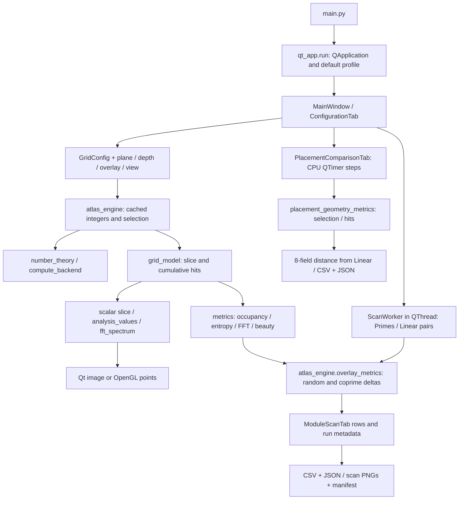

# Architecture and change-impact map

This describes the inspected implementation, not a proposed reorganization. Read [PROJECT_CONTEXT.md](PROJECT_CONTEXT.md), [RESEARCH.md](RESEARCH.md) and the discrepancy register in [BOOTSTRAP_REPORT.md](BOOTSTRAP_REPORT.md). Scientific findings and exact-case evidence remain in [SCIENTIFIC_AUDIT.md](SCIENTIFIC_AUDIT.md).

## Application and data flow



This is a dependency/data-flow diagram, not a claim that every path runs every stage. Interactive quick metrics omit random trials. The audit CLI calls the headless engine directly and writes its own CSV schema; no general-purpose application CLI exists. The scan iteration itself lives in `qt_app.ScanWorker`, not in `atlas_engine.py`.

## Module contracts

### `main.py`

- **Responsibility:** executable desktop entry point.
- **Inputs / outputs:** invocation from the source directory; exits with `qt_app.run()`'s Qt event-loop result.
- **Main symbol:** imported `run`, invoked under `__main__`.
- **Dependencies / used by:** imports `qt_app`; used by the documented launch command, not by numerical tests.
- **Scientific relevance:** none directly; startup environment and default-profile loading affect experiments. It does not force an X11/Wayland platform or set scientific parameters.

### `qt_app.py`

- **Responsibility:** application orchestration, controls, 2D/3D rendering, scan scheduling, comparison scheduling and all interactive exports.
- **Inputs / outputs:** widget values, application profile and engine dictionaries → QImages/scenes, status text, rows, semicolon CSV, JSON sidecars and PNGs.
- **Main symbols:** `run`, `MainWindow`, `ImageView`, `ConfigurationTab`, `ScanWorker`, `ModuleScanTab`, `PlacementComparisonTab`, `NumericTableItem`, `colorize`, `colorize_fft`; `APP_VERSION`, `SCAN_COLUMNS`, `SCAN_HEATMAP_METRICS`, `COMPARISON_METRICS`, `COMPARISON_COLUMNS`.
- **Dependencies / used by:** PySide6 and NumPy; engine, configuration, backend, catalog, entropy edges and spherical coordinates. Matplotlib is imported lazily for FFT colors/figures; pyqtgraph/OpenGL for 3D. Used by `main.py` and Qt/export tests.
- **Scientific relevance:** selects the analyzed field, fixes scan mode/placement, ranks scores, defines output schemas, binds run metadata and limits rendered points. UI/export logic is part of the scientific interpretation, not merely decoration.

`MainWindow.render` runs synchronously on the GUI thread after a single-shot debounce timer. It updates `current_data` and `current_image`. Scan uses a `QObject` worker moved to `QThread`, queued progress updates and cancellation between pairs. Placement comparison uses `QTimer.singleShot` between placements on the GUI thread and forces CPU; it is not another worker thread. Tables can display rounded values while CSV serializes row values.

### `atlas_engine.py`

- **Responsibility:** build volumes and scalar fields, generate placements, assemble projections and protocol/comparison metrics; provide FFT display data without GUI imports.
- **Inputs / outputs:** frozen `GridConfig`, plane/depth/overlay and current global profile → `(numbers, selected)`, scalar arrays, projection dictionaries or metric dictionaries.
- **Main symbols:** `GridConfig`, `PLACEMENTS`, `GEOMETRY_METRIC_KEYS`, `build_volume`, `build_scalar_field`, `clear_volume_cache`, `projection`, `analysis_values`, `_base_and_step`, `overlay_metrics`, `current_overlay_metrics`, `placement_geometry_metrics`, `fft_spectrum`, placement coordinate/offset helpers.
- **Dependencies / used by:** NumPy, `app_config`, `compute_backend`, `grid_model`, `metrics`, `number_theory`; consumed by GUI/workers, audit script and numerical tests.
- **Scientific relevance:** owns integer assignment, selection dispatch, field routing, Linear restriction, seed selection, comparison delta signs and residual norms. Changes propagate to all views and exports.

`GridConfig` defaults: x=y=z=10, mode=`Primes`, param=2, placement=`Linear`, start=1, placement_param=7. Plane, depth, overlay, backend and display options are separate inputs. Volume and scalar caches each retain two configurations. Their cached buffers are private: `build_volume`, `build_scalar_field` and `projection` return writable arrays isolated from internal cache storage. Plane arrays may alias the corresponding 3D arrays within one projection result, but separate public calls do not share storage. Private helpers provide controlled read-only access for internal metric paths and are not protected against deliberate private-API use. The scalar FFT explicitly allocates a private buffer before centering.

`build_volume` validates positive dimensions, the current `max_volume` on every request (including cache hits), the int64 interval and the partner arithmetic used by prime-family modes. Unknown modes/placements raise errors. Fixed planar offset maps are repeated with +zXY; helix rotates square layers or reflects rectangular layers. Seeded random and modulus weave use `placement_param`; other placements ignore it.

### `metrics.py`

- **Responsibility:** gradient, local entropy, entropy-threshold edges, spectral metrics, coprime activation, beauty and uniform random controls.
- **Inputs / outputs:** flattened fields, dimensions, bases, step, optional precomputed mask and trial/seed parameters → flattened arrays or dictionaries of numeric quantities.
- **Main symbols:** `gradient_magnitude_grid`, `local_entropy_grid`, `entropy_edge_mask`, `fft2_structure_metrics`, corresponding private NumPy/CuPy kernels, `prime_grid_metrics`, `random_baseline_metrics_for_hits`, `deterministic_seed_for_atlas`.
- **Dependencies / used by:** NumPy, math, configuration and compute backend; used by engine, GUI edge filtering, audit experiments and tests.
- **Scientific relevance:** owns definitions, units, normalization, boundary conventions and null generation. Changing names/return keys requires checking engine key lists, scan/comparison columns, heatmap selectors, exported data, tests and research descriptions.

`prime_grid_metrics` converts hits to int32, truncates hits/bases to their common length and expects dimensions compatible with that field for entropy. Its count/GCD/histogram calculations use NumPy; entropy/gradient/FFT wrappers may use CuPy. `RANDOM_BASELINE_TRIALS=12` is the direct function default; the engine normally passes `AppConfig.baseline_trials` explicitly. Both must be reviewed if defaults change.

### `number_theory.py`

- **Responsibility:** CPU sieve, scalar primality/factorization and arithmetic predicates/functions.
- **Inputs / outputs:** integers or NumPy arrays → factors, scalars, Boolean masks or float64 scalar fields.
- **Main symbols:** `prime_sieve_upto`, `prime_mask_for_values`, `is_prime`, `factorize_int`, `factorization_label`, `euler_phi_ratio`, `omega_int`, `divisor_count_int`, `mobius_int`, `is_semiprime`, `is_prime_power`, `is_square_free`, `scalar_sequence_mask`, `scalar_sequence_values`.
- **Dependencies / used by:** math, NumPy, `lru_cache`; engine, backend CPU fallback callbacks, tests. No Qt/CUDA import.
- **Scientific relevance:** sieve maximum is inclusive, not interval-relative; family partners are evaluated by engine dispatch. φ is exposed as φ(n)/n, not a standalone totient function. Positive-domain definitions and software conventions for nonpositive inputs must stay distinct.

The private CPU sieve cache grows to the largest requested value. Public `prime_sieve_upto` returns a writable copy; internal prime-mask construction reads the private buffer directly, so caller mutations cannot alter later classifications. `is_prime` and factorization each have an LRU capacity of 1,000,000; `clear_volume_cache` does not clear these caches. Large Start can demand a huge sieve even for a small volume. Scalar primality uses floating `sqrt`; the sieve uses integer `isqrt`.

### `grid_model.py`

- **Responsibility:** axis/shape selection, inclusive cumulative hit counts and spherical coordinates.
- **Inputs / outputs:** arrays `(Z,Y,X)` and plane/depth → 2D number/selection/hit arrays; coordinate indices and shell parameters → `(N,3)` float32 positions.
- **Main symbols:** `plane_dimensions`, `get_depth_limit_for_plane`, `get_plane_data`, `spherical_shell_positions`.
- **Dependencies / used by:** NumPy; engine projection and GUI 3D, geometry tests.
- **Scientific relevance:** defines axis order and hit accumulation, but does not assign integers. `get_plane_data` always computes cumulative hits, independently of `overlay_enabled`. Unknown planes fall through to YZ; only the engine wrapper clamps upper depth.

Spherical coordinates use θ=2π(x+0.5)/X+z·rotation·π/180, h=1−2(y+0.5)/Y, and R=max(0.1,inner_radius)+z·max(0.01,spacing). Coordinates are R·(sqrt(1−h²)cosθ, sqrt(1−h²)sinθ, h). Cells have equal area within each shell, not equal distances; rotation changes radial alignment between shells. This function never changes primality or computes a spherical FFT.

### `compute_backend.py`

- **Responsibility:** lazy CuPy discovery/probing, requested CPU/Auto/GPU mode, accelerated prime/GCD masks, conversion helpers and CPU retry.
- **Inputs / outputs:** requested mode, element count, arrays and fallback callback → backend choice, NumPy arrays, diagnostics; module-global backend state.
- **Main symbols:** `configure_backend`, `should_use_gpu`, `gpu_module`, `prime_mask`, `coprime_mask`, `disable_gpu`, `release_gpu_caches`, `to_numpy`, `scalar`, `backend_summary`, `backend_error`.
- **Dependencies / used by:** NumPy, math, configuration; lazy CuPy. Engine, metrics, GUI and backend tests consume it.
- **Scientific relevance:** Auto uses element count ≥ configured threshold (default 65,536); GPU forces acceleration only when probing succeeds. Failure disables CUDA for the process and supported callers retry CPU. Requested GPU is not evidence of actual GPU execution.

The probe tests reductions, sqrt/log2, padding, FFT and sieve-like slicing. A cached device sieve uses small CPU primes. Scan releases unused plans/pools every 128 pairs and on exit. OpenGL is a separate rendering backend. No end-to-end GPU residency is implemented; engine outputs are NumPy arrays and random draws are NumPy CPU draws.

### `app_config.py`

- **Responsibility:** frozen `AppConfig`, validated process-wide settings and JSON profile I/O.
- **Inputs / outputs:** dataclass/profile JSON → clamped/coerced configuration snapshots; saved JSON.
- **Main symbols:** `AppConfig`, `CONFIG_SCHEMA_VERSION`, `DEFAULT_CONFIG_PATH`, `validate_config`, `get_config`, `set_config`, `reset_config`, `config_dict`, `load_config`, `save_config`, `load_default_config_if_present`.
- **Dependencies / used by:** standard library only, including `RLock`; engine, metrics, backend, GUI, tests and audit script.
- **Scientific relevance:** defaults control metric definitions and seeds. `load_config` ignores unknown keys; omitted keys get defaults; schema is forced to the current value. There is no migration pipeline or general finite-number validation. Validation is clamping/coercion, not strict rejection of every out-of-range setting.

The default file is `prime_atlas_config.json` beside the module. A profile is not the full experiment: it lacks GridConfig, plane/depth/overlay and requested backend. Getter/setter locking does not make a whole numerical job atomic. Direct profile changes do not invalidate volume caches; the GUI's `apply_app_config` explicitly clears them.

### `mode_catalog.py`

- **Responsibility:** UI groups and supported mode names, not numerical dispatch.
- **Inputs / outputs:** static tuples `PRIME_MODES`, `CONTROL_MODES`, `DIAGNOSTIC_MODES`, `MODE_GROUPS`, `ALL_MODES`.
- **Dependencies / used by:** no imports; GUI and catalog/core tests.
- **Scientific relevance:** 4+4+5 modes. Adding a catalog entry alone does not implement its mask/scalar field, parameter controls, rendering or tests.

### `tools/scientific_audit_experiments.py`

- **Responsibility:** deterministic, separate exploratory experiments and optional plot generation.
- **Inputs / outputs:** `--output`, `--trials`, `--replicates`, `--seed`, `--plots` → 11 comma-delimited CSVs, source/environment manifest and optional null-comparison PNG.
- **Main symbols:** `measure`, `write_csv`, `run`, `make_plots`, argparse entry point.
- **Dependencies / used by:** standard library, NumPy, headless modules; optional Matplotlib for plots. Used by audit reproduction commands, not GUI.
- **Scientific relevance:** fixes CPU/default profile and supplies two coprime-conditioned controls absent from the application baseline. Its quantiles and inclusive empirical tails are exploratory, not formal p-values or confidence intervals. The output schema differs from GUI CSV.

## Field and projection contracts

`projection` returns `numbers`, `selected`, `hits`, `visible_depth`, `numbers_3d`, `selected_3d`, `proj_x`, `proj_y`, `depth`, `depth_limit`, and optionally `mode_values`. Depth None selects the final level. Public array results are writable and isolated from private cached buffers and from other public calls: caller mutations cannot affect later projections or scientific computations. Within one result, `numbers` may be a view of `numbers_3d`, `selected` a view of `selected_3d`, and `mode_values` a view of that result's private scalar-field copy. `hits` is an independently allocated sum. Cache clearing affects future internal reuse but does not invalidate arrays already returned to callers. This contract does not promise process-wide experiment isolation, thread safety or protection from deliberate access to underscore-prefixed helpers. CPU behavior is regression-tested; CUDA requires real hardware and is not certified by CPU fallback.

Array rows/columns are XY=(Y,X), XZ=(Z,X), YZ=(Z,Y); accumulated axes are z/y/x. `hits` are int32 inclusive sums even without overlay; visible_depth is k+1 with overlay and 1 otherwise.

| Consumer | Selection mode, no overlay | Selection mode, overlay | Scalar diagnostic |
|---|---|---|---|
| Classic | Boolean selection | Hit-based color strength | Residue palette, signed μ or scalar heatmap |
| Heatmap | Integer slice | Raw hits | Current scalar slice |
| Normalized heatmap | Min/max scaling with denominator at least 1 | hits/(k+1) | Min/max scaling of current scalar slice |
| Gradient / local entropy / entropy edges | Integer slice | hits/(k+1) before operator | Current scalar slice before operator |
| FFT view | Boolean selection | Binary hits>0 | Current scalar slice, preserving signs/amplitudes |
| `overlay_metrics` / scan | Always cumulative; GUI scan is Primes/Linear | Raw-hit entropy; binary FFT | API can accept scalar modes but metrics still use selection/hits; GUI scan never does |
| `placement_geometry_metrics` | Boolean selection | Raw hits with binary FFT | Same selection/hit contract, not scalar analysis |

Do not conflate raw numerical normalization with palette normalization: most non-Classic colors are again scaled by their current minimum/maximum. FFT pixels are flipped vertically for Qt's top-left origin; numerical spectra are not changed. Grid numeric labels show integers, not necessarily the analytical scalar values.

## Metric contracts for maintenance

Definitions complement the input/range notes in [RESEARCH.md](RESEARCH.md). Ranges assume compatible finite inputs and positive dimensions/step. Let N=W·H, h be nonnegative hits, d the accumulated depth count, C the coprime mask and A=(h>0).

| Output | Input and definition | Output/range | Interpretation and limitation |
|---|---|---|---|
| `alive_density` | mean(A) | [0,1] | Projected occupancy, not volume prime density |
| `coprime_alive_ratio`, `noncoprime_alive_ratio` | Alive fraction within C / its complement | [0,1], zero on empty denominator | Conditional occupancy; YZ complement is empty |
| Four class counts | Count C, complement and each alive intersection | Integers 0…N | Preserve exceptional prime terms |
| `global_entropy` | Base-2 entropy of exact h-value frequencies, including 0 | 0…log2(min(N,d+1)) | Histogram entropy, invariant under cell permutation |
| `local_entropy_mean` | Mean 3×3 Shannon entropy; globally min/max-quantized B bins; replicated edges | 0…log2(min(B,9)); B=8 discrete maximum ≈2.9477 | Depends on field, density, bins and boundaries; not normalized to [0,1] |
| `edge_density` | Fraction Hloc≥Hmin+r(Hmax−Hmin), default r=.72; zero if constant | [0,1] | High-entropy fraction, not gradient/contour density |
| `fft_peak_ratio` | max(P)/sum(P) | Nominally [0,1] | Spectral concentration; occupancy/parity can force a peak |
| `fft_axis_ratio` | Central row/column non-DC power / total | Nominally [0,1] | Orientation/shape dependent; H+W−2 included bins |
| `fft_lowfreq_ratio` | Power at 0<radius≤max(1,.18·max_radius) / total | Nominally [0,1] | Radius uses FFT indices, not isotropic normalized frequencies |
| `fft_spectral_entropy` | −sum(q log2 q)/log2(W·H−1), q=P/sum(P) over positive bins | Nominally [0,1]; zero for ≤2 cells or zero power | Fixed denominator is symmetry-stable; raw values differ from the audit-era K+ definition |
| `beauty_score` | max(0,Rc−Rn)·(1+wH·Hloc+wE·edge)·exp(−decay·(density−target)²) | Nonnegative; conservative default upper bound 2.7 | Configurable heuristic; no universal bound if weights change, no significance |
| `structural_score` | Bobs−mean(Brandom) | Signed; not restricted to [0,1] | Uniform null does not remove modular admissibility |
| `random_*`, `delta_*` | Random mean; observed minus that mean | Metric-dependent; deltas signed | No trial variance exported by engine |
| `coprime_mask_*`, `delta_coprime_*` | Binary-mask metric; observed minus mask metric | Metric-dependent; deltas signed | Binary control is not a matched hit distribution |
| `coprime_residual_l1/l2` | Norms of seven coprime metric deltas | Nonnegative | No pixel comparison, standardization or covariance; density excluded |
| `distance_from_linear` | Euclidean norm of eight comparison metric differences | Nonnegative, zero at Linear; NaN if reference missing | Includes density; unstandardized, not a protocol or significance test |
| Gradient magnitude | Centered interior / one-sided boundary differences; singleton derivative zero | Nonnegative, unbounded by definition | Visualization field, not a scan metric |

P is squared magnitude of a centered, unwindowed, unpadded FFT2 after fftshift and explicit DC zeroing. Display uses log1p(P), ratios do not. One-dimensional nonconstant fields are evaluated; zero power, zero dimensions or insufficient input samples return zero. Do not convert invalid zeros into evidence of no structure.

The random baseline fixes K=count(h>0), chooses K distinct positions uniformly over N cells, and samples K positive observed values **with replacement**. K=0 has an early return; otherwise at least one trial runs even if a headless caller requests zero. The engine can still report the caller's zero trial count: a known discrepancy. Derived seeds use deterministic XOR of dimensions, Start, plane and placement codes; explicit nonnegative profile seed overrides them; RNG masks to 32 bits. The legacy `Lineare` seed alias is not a supported placement name in `build_volume`.

## Configuration, state and exports

`config.example.json` matches AppConfig defaults. There is no `examples/` directory. When changing a field, trace default → coercion/clamp → GUI range → consumer → snapshot/export → test → documentation. `export_max_side` is currently exposed but unused by `save_heatmap_figure`, which uses 10×8 inches at 180 dpi. Do not document a working size cap until behavior is deliberately resolved.

### Preventive memory policy

`memory_policy.py` applies a hybrid, operation-local allocation budget before
predictably large allocations. `memory_budget_mb` is historically named but is
explicitly measured in MiB (2^20 bytes); its default is 1024. It caps the
estimated **additional peak** for one operation, not process RSS, physical RAM
or a mathematical grid size. `memory_available_fraction` defaults to 0.50. The
effective host budget is the minimum of the configured cap, that fraction of
OS-available memory, that fraction of detectable cgroup headroom, and
`RLIMIT_AS` virtual-address headroom. RSS is reported only as already resident
context and is not subtracted again. When dynamic sources cannot be read, the
configured cap remains active with `configured-cap-only` confidence; total
physical RAM is never substituted for available memory.

`MemoryEstimate` separates already allocated, persistent, temporary and
host/device-transfer bytes. `MemoryBudgetExceeded` derives from `MemoryError`
and exposes the operation, additional and total estimated peaks, effective
budget/source, dominant components and confidence. Headless calls propagate
this structured error. GUI rejections preserve the last valid render and do not
rewrite dimensions, Start or trial counts. Scan checks occur before constructing
the pair list/worker; 3D checks occur before `np.indices`. A rejected operation
does not clear valid caches or produce a completion manifest.

The estimates use Python integers and a 20% safety margin. Volume/projection
models itemize int64 numbers, boolean selections, scalar fields, public copies,
placement temporaries and the fact that an LRU miss can coexist with old
entries. CPU/GPU sieve models include the growing bool sieve, old cache, public
copy, masks, int64 indices and transfers. Local entropy models the actual bin
count, padded int32 grid, `(bins,y,x)` int32 counts and float64 probability/term
tensors (the STEP 06A observation at eight bins was about 350 bytes/cell). FFT
metrics and display have distinct conservative starting coefficients of 110
and 72 bytes/cell. Overlay uses 400 bytes/cell for Linear and 520 for Python-
heavy placements, plus resident volume context; sequential trials do not
multiply the peak. Scan includes Python pair/result objects and the maximum
single-operation peak. 3D includes dense coordinates, masks, positions and
colors before subsampling.

CUDA admission uses CuPy's device free-memory report when available and never
infers VRAM from host RAM. The memory-pool value is not subtracted separately
from already reported free VRAM. If device memory is unknown, the configured
device cap remains a documented limitation. A device-budget rejection is not
treated as a generic CUDA failure: the independent host estimate must admit the
CPU fallback. Mocked CUDA resource tests validate policy routing only, not real
CUDA execution.

This is an operational guard, not an absolute OOM guarantee. Coefficients vary
with NumPy/CuPy, FFT libraries, allocators and Python object layouts; abrupt
external pressure, fragmentation, memory-mapped/device allocations and
concurrent writers can still cause a real `MemoryError`. The policy deliberately
does not change formulas, FFT normalization, sieve mathematics, LRU policy,
scientific output formats, or approximate an excessive request by resizing it.
`export_max_side` remains descriptive/unused and exports are never silently
resized by this policy.

Top-level operation guards compose these local estimates to close MEM-01, the
nested-allocation budget bypass found during final review. A local guard answers
whether one allocation is admissible; it does not by itself protect a caller
that retains earlier buffers. `compose_estimates` therefore models ordered
phases. New persistent buffers remain live in every later phase, while
temporary/transfer peaks from mutually exclusive phases use their maximum
rather than their sum. Already-margined child estimates are not margined a
second time. For example, a cold 25,000,000-cell Linear public volume retains
the newly cached volume while allocating its defensive copy; both are included
in the caller's preflight before either allocation starts.

The engine tracks the two configuration keys expected to be resident in each
LRU solely so a warm operation can budget its public copy without pretending a
new cache entry is required. This bookkeeping follows accesses through the
existing private entry points, is cleared with the caches, does not expose
arrays and does not alter eviction capacity or cached values. A cold estimate
conservatively includes the new entry before eviction, sieve growth for prime
modes, scalar fields where applicable, retained projection products and later
metric/display phases. Scan and placement comparison force a cold estimate
because their configurations change; interactive rendering composes the
projection snapshot with analysis, RGB and QImage buffers. If buffer lifetime
is uncertain, the model retains it through the next phase. This can reject a
request conservatively but cannot provide cross-thread reservations or a
guarantee against concurrent memory pressure.

MEM-02 corrected scalar LRU tracking for cached `None` results. All engine
scalar-cache accesses pass through one helper that updates the key registry
after a successful cache return, including `None`, and before public copying.
Construction failures do not update the registry; a later public-copy failure
does not undo an already successful cache access. This matches sequential LRU
hits, eviction and clear behavior without claiming thread safety.

Scan metadata snapshots configuration at start and records `_scan` parameters/status plus `application_version`. It is not an immutable runtime execution context: worker calls still consult shared global configuration/backend. Scan and placement comparison disable Grid/Configuration locally but can overlap across tabs; no global job lock exists. Run them sequentially. Capture requested and actual backend separately for scientific reproduction.

| Export | Producer and format | Metadata / consumers / limits |
|---|---|---|
| Scan table | `ModuleScanTab.export_csv`; 58 `SCAN_COLUMNS`, semicolon, `extrasaction=ignore` | Sibling `.config.json`; engine `step` is omitted. GUI sorting/heatmaps and external CSV users depend on keys |
| Placement table | `PlacementComparisonTab.export_csv`; 11 columns = placement, classification, eight metrics, distance | `.config.json` with captured grid/profile/reference; no complete run-status/actual-backend provenance |
| Batch scan figures | `save_all_metric_screenshots`; 22 `SCAN_HEATMAP_METRICS` PNGs | `metric_screenshots.json` includes metric names, captured scan and profile |
| Single scan figure | `save_selected_screenshot` → `save_heatmap_figure` | Annotated Matplotlib figure; no full sidecar |
| Grid PNG | `MainWindow.save_png` | Captures viewport including current zoom/overlays; no full sidecar |
| FFT PNG | `MainWindow.save_fft` | Matplotlib log-power figure, title and colorbar; no full sidecar |
| Audit experiments | `tools/scientific_audit_experiments.py` | Comma-delimited data plus independent manifest; preserve old outputs when rerunning |

CSV/batch metadata do not include every commit/dependency/actual-backend detail. Historical `results/` manifests predate current provenance changes. Preserve them rather than repairing their labels. Rendering subsamples at most `max_3d_points` equally spaced flattened indices; it does not subsample engine metrics. Qt/OpenGL visual tests and numerical tests cover different claims.

## Scientific provenance sidecars

Future interactive exports add a sibling `<complete-output-name>.manifest.json`
using schema `pga.provenance/1.0`: for example, `atlas.csv` produces
`atlas.csv.manifest.json` and `atlas.png` produces
`atlas.png.manifest.json`. Preserving the complete filename prevents CSV/PNG
collisions for a shared stem. The batch sidecar is
`metric_screenshots.json.manifest.json`. Existing CSV, PNG, `.config.json` and
`metric_screenshots.json` contents and names are unchanged. The common
standard-library implementation is in `provenance.py`; historical Research I
and Research II scripts, manifests and published datasets do not use this new
schema and remain immutable evidence.

The public API is:

- `collect_source_identity(project_root, source_paths)`: hash a curated source
  set and, only when `project_root` is itself the Git top level, observe the
  full commit and working-tree clean/dirty state without exporting filenames;
- `collect_environment(...)`: record an allow-listed Python, package and coarse
  platform environment;
- `new_experiment_manifest(...)`: create an in-memory run record with a UUID,
  start time and requested/effective configuration;
- `finalize_experiment_manifest(...)`: classify and hash outputs relative to an
  authorized directory;
- `write_manifest_atomic(...)`: serialize strict JSON to a temporary sibling
  and replace the destination atomically;
- `sha256_file(...)`: calculate SHA-256 incrementally with constant memory.

GUI exporters additionally use `ExportConsistencyGuard`. Before changing an
existing output, the guard moves a recognized active PGA manifest to a uniquely
named `.inactive-<uuid>.json` location. An unrecognized file at the active
sidecar path stops the export before any output is changed. On a handled
failure, the old manifest is restored only if all of its output sizes and
SHA-256 values still match; otherwise it remains clearly inactive and no stale
manifest occupies the active path. Successful replacement removes the inactive
copy. Before invalidation, the guard also rejects duplicate destinations,
manifest self-overwrite and user output names ending in the reserved
`.manifest.json` suffix, preventing an output from replacing another export's
active sidecar. This is a conservative consistency protocol, not a general
transaction.

Manifest states are `running`, `completed`, `failed`, `cancelled` and
`partial`. Output states are `complete`, `partial`, `missing` and `invalid`.
Missing or invalid required outputs prevent a `completed` state. Interactive
runs usually have no export destination when calculation starts, so their
running state exists only in memory: the manifest is first persisted after the
user selects a destination. `experiment_started_at`,
`experiment_completed_at` and `exported_at` distinguish these events.
Each present output separately records `binary_integrity: verified_sha256` and
`scientific_completeness`. A cancelled scan/comparison can therefore have a
well-formed, hashed CSV with `status: partial`, while its complete configuration
sidecar uses scientific completeness `not_applicable`.

Source identity has deliberate limits. A clean Git commit plus observed file
hashes identifies files on disk at observation time; it does not certify code
already loaded in memory. Dirty repositories retain the commit only as a base
identity. Extracted archives and directories without a pertinent `.git` use
`file_hashes_only`. Filesystem timestamps are not identity evidence. A Git
repository above an extracted project is rejected, and no remote, branch,
author, email, hostname, username, untracked filename or environment-variable
dump is exported. Long-running scan/comparison runs retain an initial source
observation and compare its curated file hashes with the export-time
observation; interactive rendering compares the application-start observation
with export time. `loaded_code_identity` remains `not_verified`, because disk
hashes do not prove the identity of modules already resident in memory.

Backend fields separate `requested_backend`, `effective_backend`,
`result_origin`, `producer_backend`, `backend_evidence` and
`fallback_events`. CPU explicitly forced by an experiment is attributable to
CPU. Other GUI paths currently lack per-operation instrumentation and therefore
record a null effective/producer backend rather than inferring it from current
global state. Cache is an origin, never a computational backend; a directly
observed cache hit without entry metadata would use `result_origin: cache`,
`producer_backend: null` and `backend_evidence: cache_hit_unattributed`.
PGA-ARCH-04 remains deferred until cache entries and operations can carry
experiment-local evidence without a shared global event list.

Example, abridged:

```json
{
  "schema": "pga.provenance/1.0",
  "schema_version": "1.0",
  "experiment_id": "550e8400-e29b-41d4-a716-446655440000",
  "application": {"name": "Prime Grid Atlas", "version": "1.0.0"},
  "source": {
    "identity_status": "git_commit_and_file_hashes_clean",
    "git": {"available": true, "commit": "<full-sha>", "dirty": false},
    "loaded_code_identity": "not_verified"
  },
  "experiment": {
    "kind": "module_scan",
    "status": "completed",
    "experiment_started_at": "2026-11-26T12:00:00Z",
    "experiment_completed_at": "2026-11-26T12:01:00Z",
    "exported_at": "2026-11-26T12:02:00Z",
    "command": null,
    "command_status": "not_recorded_for_privacy"
  },
  "compute": {
    "requested_backend": "Auto",
    "effective_backend": null,
    "result_origin": "computed",
    "producer_backend": null,
    "backend_evidence": "not_observed_per_operation",
    "fallback_events": []
  },
  "outputs": [
    {"path": "atlas.csv", "status": "complete", "size": 1234, "sha256": "<sha256>", "required": true}
  ],
  "warnings": [],
  "limitations": []
}
```

Manifest JSON rejects NaN and Infinity. Output paths use relative POSIX form;
path traversal, external symlinks, external files and self-reference are
invalid. SHA-256 is computed after each output is written. The manifest itself
is not listed as its own output. Atomic replacement protects an earlier valid
manifest if serialization or writing fails, but does not make the set of CSV,
PNG and sidecar files transactional and cannot guarantee survival of every
power failure. Errors intended for manifests must be structured and sanitized;
raw CUDA and traceback text remains outside this provenance format.

The FFT export uses the snapshot attached to `current_data` as its effective
data-source configuration. Widget values observed later are recorded separately
under `current_widgets_at_export`, while the overlay choice and DPI actually
used by the export are explicit FFT options. Deferred UI rendering therefore
cannot retroactively relabel the data already held by the application.

The provenance module follows an allow-list for environment and Git fields, but
it is not a universal sanitizer for arbitrary metadata supplied by callers.
Callers must provide controlled scientific configuration, warning and
limitation values. GUI callers satisfy this contract with numeric/enum widget
snapshots and fixed application-authored text; secrets, raw exceptions,
personal paths and unrestricted environment data must never be passed in.

An abrupt process termination can still occur between output replacement and
new-manifest publication, leaving no active manifest and an inactive previous
one. Concurrent writers to the same destination are not serialized. Consumers
must require an active sidecar and verify every recorded size and checksum;
inactive manifests are evidence only and never describe the current export.

The RNG section records only an actually supplied or implementation-observed
seed/constructor and explicitly does not claim universal reproducibility.
Version, seed and environment metadata cannot eliminate platform, dependency,
floating-point or algorithm-version differences.

## Change routes and tests

All tests are `unittest` tests; `tests/scientific_reference.py` supplies independent enumeration/recurrence/direct-DFT oracles and a CPU/config/cache fixture. Tests use flat source imports, so run from the project root. Qt tests use offscreen mode and skip without PySide6. A real-GPU test skips without CuPy/CUDA and rejects silent fallback if it runs.

| Change | Mandatory impact trace | Focused tests |
|---|---|---|
| Projection/overlay | `grid_model` → engine routing/base-step → GUI labels/render → scan/comparison/export → methodology | `test_projections`, `test_linear_embedding`, `test_coprime_mask`, `test_core`, `test_scientific_ui` |
| New/changed metric | `metrics` → `GEOMETRY_METRIC_KEYS` / overlay assembly → scan columns/heatmaps and comparison fields → both CSV schemas and audit KEYS → docs | `test_metrics`, `test_fft_metrics`, `test_random_baseline`, `test_export_provenance`; independent small-case oracle |
| Mode/placement | Catalog/constants → generation/scalar dispatch → parameter enablement/help/presets → comparison and seed mapping → exports | `test_core`, `test_number_theory`, `test_placements`, `test_scientific_ui` |
| Configuration | AppConfig/defaults/validation → GUI ranges → actual consumer and cache invalidation → example and metadata | `test_core`, `test_known_scientific_issues`, `test_export_provenance` |
| CPU/GPU | Probe, retry, caches, dtype/roundoff → scientific metrics → status/provenance | `test_backend`, `test_fft_metrics`, CPU suite plus actual GPU when available |
| Export/version | Constants/serializers → captured vs live state → consumers → CFF/README/version policy | `test_export_provenance`, `test_scientific_ui`; compare actual written headers/JSON |

Typical commands (using the active environment's Python):

```bash
python -m compileall .
python -m unittest discover -s tests -v
python -m unittest discover -s tests -p test_projections.py -v
python -m pytest
```

Pytest is not declared as a dependency or configured in this repository. Run it if available; report absence instead of claiming success or adding dependencies silently. The established unittest command remains the baseline. For a small independent experiment smoke run, use a temporary output directory:

```bash
python tools/scientific_audit_experiments.py --output /tmp/prime-atlas-smoke --trials 2 --replicates 1 --seed 20260910
```

Do not overwrite curated `docs/scientific_audit/` merely to test the CLI. The documented historical test totals are snapshots, not a substitute for running the current suite. `test_known_scientific_issues.py` intentionally tracks unresolved expectations; unexpected success needs investigation rather than automatic removal of the decorator.
