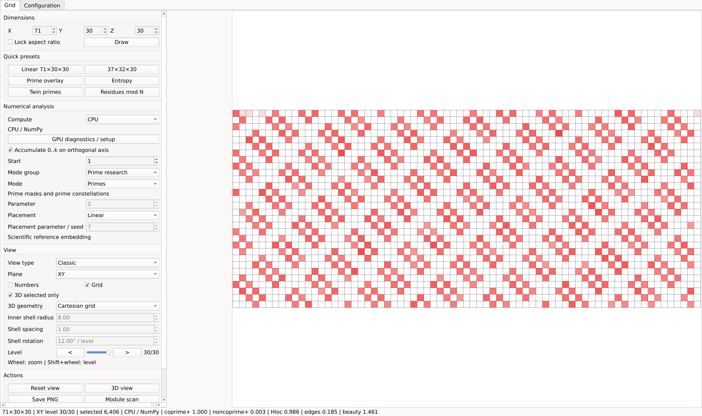
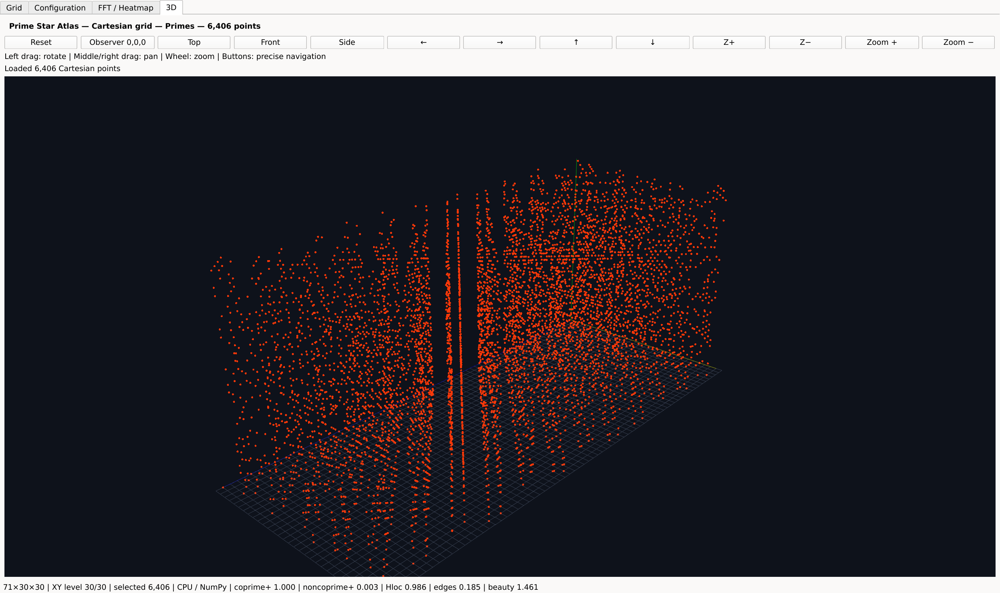
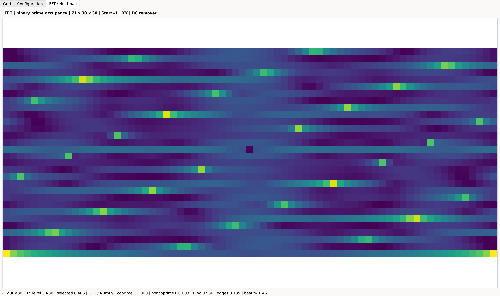
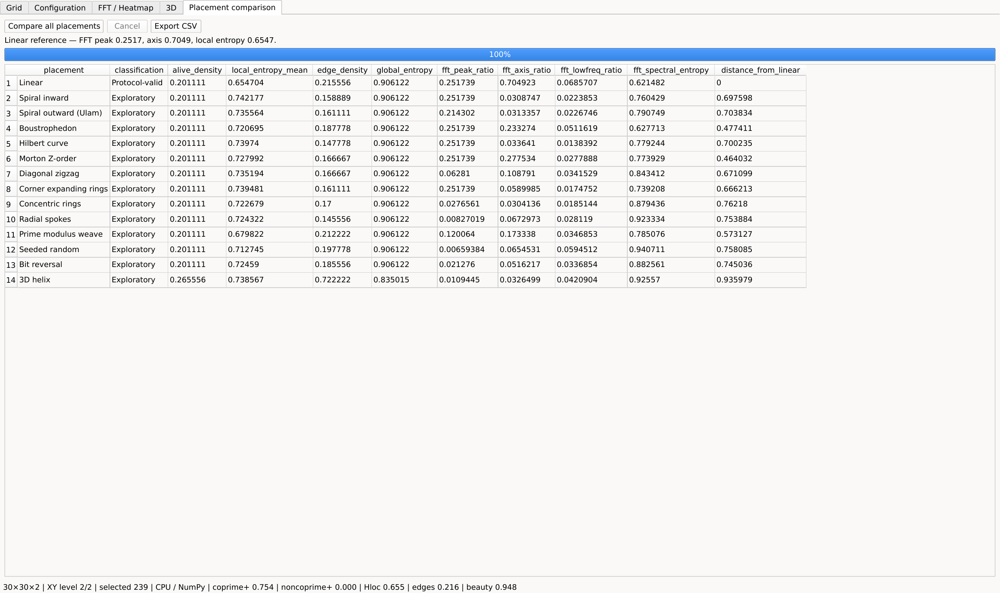
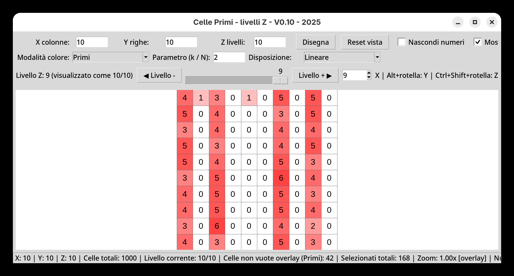

# Prime Grid Atlas

**1.1.0 — Integrity, Reproducibility & Reliability Update**

Original author: **zampro79**.

Prime Grid Atlas is a desktop laboratory for experimental number theory. It maps
integers into finite grids, displays arithmetic subsets and compares measured
patterns with modular and randomized controls.

> **Known native crash risk:** R08-08 remains **HIGH / OPEN / NOT REPRODUCED /
> ROOT CAUSE UNKNOWN**. A crash can lose unsaved results or interrupt an export.
> Read [Known Issues](KNOWN_ISSUES.md) before relying on a run.

## Scientific scope

Visual patterns, rankings and heuristic scores are not proofs, discoveries or
automatic significance tests. Technical validation is not academic certification.
The [implemented research framework](RESEARCH.md) defines fields, metrics and
controls; [research findings](RESEARCH_FINDINGS.md) separate mathematical results
from finite experimental observations.

## Screenshots and gallery

These authentic desktop captures were generated from application source
**S = eaf6c433722521c5f0dd6a6b07e112e643b5d05b**, runtime **1.1.0**.
They are demonstrations, not evidence of a new mathematical discovery.









See the [complete gallery](examples/release-1.1.0/GALLERY.md),
[local HTML gallery](examples/release-1.1.0/gallery.html),
[seven reproducible examples](examples/release-1.1.0/README.md),
[validation](examples/release-1.1.0/VALIDATION.md),
[actual provenance export](examples/release-1.1.0/07-provenance-export/README.md)
and [Known Issues](KNOWN_ISSUES.md). Coprimality, scan, viewports and the
OpenGL framebuffer are included in the separate gallery. FFT viewport images
are qualitative; the numerical matrix and native Matplotlib export are supplied.
A later documentation commit D does not replace S in the original manifests.

## Project Origins

Prime Grid Atlas originated from a discussion at my local chess club on a Friday evening in October 2025.

Observing several stacked vinyl tournament chessboards led to a discussion about playing chess across multiple levels and identifying each square through three-dimensional coordinates.

This inspired the idea of arranging integers across successive numerical grids and cumulatively projecting prime-number occurrences along the Z-axis.

The first implementation was Celle Primi — livelli Z (V0.10), a small Python/Tkinter application whose original source is preserved in this repository.

[Read about the project's origins](history/README.md).



## Features

- Prime families, coprime and arithmetic controls, residues, divisor counts,
  Möbius values and GCD diagnostics.
- XY/XZ/YZ slices, accumulated hit maps, gradients, entropy and 2D FFT.
- Fourteen placements, descriptive parameter scans and Cartesian/spherical 3D.
- Native CSV/configuration/PNG exports and provenance sidecars on supported paths.
- Defensive cache copies and preventive operation-local memory budgets.
- NumPy CPU computation and optional CuPy routing; real CUDA is not validated here.

## Mathematical framework

For zero-based coordinates, Linear placement uses
`n(x,y,z) = Start + x + X*y + X*Y*z`, with arrays shaped `(Z,Y,X)`.

| Plane | Step along the accumulated axis | Matrix shape |
|---|---:|---|
| XY | X*Y | (Y,X) |
| XZ | X | (Z,X) |
| YZ | 1 | (Z,Y) |

`gcd(base, step) = 1` defines modular admissibility, not primality; exceptional
primes dividing the step require separate treatment. The application random
control fixes occupancy, randomizes positions over the full plane and resamples
positive hits with replacement. It is not coprime-conditioned or exact-histogram.
See [RESEARCH.md](RESEARCH.md) and [ARCHITECTURE.md](ARCHITECTURE.md) for details.

## Installation

Use a compatible existing Python environment or create a local environment for
a new installation. Commands below use relative paths; dependency installation
is a reader action.

```bash
python -m venv .venv
source .venv/bin/activate
python -m pip install -r requirements.txt
python main.py
```

Use the appropriate relative activation command for another shell. Recorded
validation uses Linux/Python 3.14.10; other platforms are not validated by API
simulations. A desktop is required for interactive use and OpenGL for 3D.
The optional CUDA profile is [requirements-gpu-cuda12.txt](requirements-gpu-cuda12.txt).
Requested GPU mode is not proof of actual GPU execution; inspect backend status.

## Quick start

Begin with a small grid and select **CPU**. Record dimensions, Start, mode and
parameter, placement and parameter, plane, depth, overlay and the complete
configuration. Keep native exports and sidecars together in a new output directory.
The [software manual](doc/software_manual.md) describes the interface.

## Reproducible examples

The [seven demonstrations](examples/release-1.1.0/README.md) cover prime
occupancy, coprimality, Cartesian 3D, FFT, placement comparison, scan and
[scientific provenance](examples/release-1.1.0/07-provenance-export/README.md).
They include full configurations, seed policy, observed environment/backend,
source S, numerical results, authentic images, native sidecars and checksums.
They are separate from Research I/II. Reproduction uses a clean checkout of S
and separate diagnostic output; original evidence is not overwritten. See
[the integration/provenance record](examples/release-1.1.0/INTEGRATION.md).

## Research I and Research II

- [Research I audit](SCIENTIFIC_AUDIT.md) and
  [historical reproduction evidence](docs/reproducibility/research_i/README.md).
- [Research II theory and experiments](research_ii/PRIME_GRID_ATLAS_RESEARCH_II.md).

Current fixed non-DC Research I reruns are distinct from exact historical
reproduction; the complete original source provenance remains unresolved.
Use new, separate output directories, never the preserved datasets:

```bash
python tools/scientific_audit_experiments.py --output results/repeat-research-i --trials 500 --replicates 50 --seed 20260910
python research_ii/verify_theorems.py
python research_ii/research_ii_experiments.py --output results/repeat-research-ii --trials 240 --seed 20261126
```

Choose new directory names if those already exist. Research II is independently
implemented. Numerical agreement does not establish statistical significance.

## Scientific provenance

Supported exporters record observed source identity, effective configuration,
environment, backend evidence and output hashes. Unknown provenance remains
unknown. A documentation summary is not a native manifest; preserve emitted
sidecars unchanged. Hashes establish byte integrity, not scientific completeness.
See [the architecture](ARCHITECTURE.md#scientific-provenance-sidecars).

## Resource management

The default cap is **1024 MiB of estimated additional memory per operation**.
Checks compose persistent buffers and mutually exclusive work, including
bin-dependent entropy temporaries. Available memory, mapped cgroup headroom and
optional POSIX limits constrain admission where observable. This is not a
reservation or universal upper bound; see [memory policy](ARCHITECTURE.md#preventive-memory-policy).

## Validation

```bash
python -X faulthandler -m unittest discover -s tests -v
```

The STEP 10R preparation working tree completed 169 tests in each existing Linux CPU
environment: 168 passed and one real-CUDA test skipped. Fresh Research I fixed
non-DC and Research II reruns matched 11/11 and 4/4 relevant baseline CSVs in each
environment; compileall and the Research II verifier also passed. These checks
apply to the observed source hashes and environments; source and artifact acceptance checks are documented in the
[1.1.0 checklist](RELEASE_CHECKLIST_v1.1.0.md).
The integrated desktop evidence identifies S and its actual Linux Wayland/driver
environment; see [visual validation](examples/release-1.1.0/VALIDATION.md). No CUDA
or general thread-safety certification is claimed. The historical prototype is
not imported by current application tests and is outside this scientific validation.
STEP 10R.4 repeated both full suites and the Research II verifier, recalculated
only the demonstration examples on a clean S checkout, and checked the preserved
Research I/II outputs without regenerating those studies. The
[integration checksum index](EDITORIAL_SHA256SUMS) covers the integrated assets
and updated documents, excluding the index itself; it is not a complete-distribution checksum.

STEP 10R.6 validated the complete 205-file distribution from documentation
commit D = 5335d72191458021145c5a6553dd81efc9d3fc67, including full-distribution
privacy, local links and the current CFF schema. Both existing Linux CPU
environments passed 169 tests (168 passed, one CUDA skip), compileall and the
Research II verifier; fresh Research I/II reruns matched 11/11 and 4/4 baseline
CSVs respectively. This validation does not resolve R08-08. The author
explicitly accepted that residual risk for publication in STEP 10R.9; that
step did not authorize publication.

## Known issues

Read [KNOWN_ISSUES.md](KNOWN_ISSUES.md), including R08-08, platform/CUDA limits,
shared runtime state, export atomicity, memory estimates and incomplete historical
Research I provenance. See also [release notes](RELEASE_NOTES_v1.1.0.md).

## Citation

[CITATION.cff](CITATION.cff) provides the citation metadata for **version 1.1.0**:
DOI **10.5281/zenodo.24573039**, author **zampro79**, and author-authorized
`date-released` **2026-11-27**. Cite the version used in your work.

The original publication remains:

> zampro79. (2026). *Prime Grid Atlas* (Version 1.0.0) [Computer software].
> Zenodo. https://doi.org/10.5281/zenodo.24546973

That version DOI identifies **1.0.0 only**. Concept DOI
[10.5281/zenodo.24546972](https://doi.org/10.5281/zenodo.24546972) identifies the
version family; it is distinct from both version-specific DOIs. The
1.1.0 DOI does not replace the 1.0.0 DOI. See [ZENODO.md](ZENODO.md).

## License and authorship

Copyright (c) 2026 **zampro79**, original author of Prime Grid Atlas.
[MIT License](LICENSE); dependencies retain their own licenses, including Qt/PySide6
terms. See [CONTRIBUTING.md](CONTRIBUTING.md). Publication requires a separate
explicit author decision.
