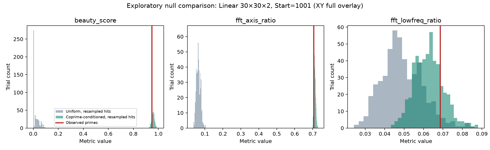

# Prime Grid Atlas — Scientific Audit

## Executive summary

Audit scientifico del codice v1.0.0, successivo e distinto dalla preparazione editoriale. **La mappatura Linear, le slice, gli accumuli, i passi aritmetici, le maschere prime e le funzioni aritmetiche verificate corrispondono alle definizioni ricostruite dal codice. Questo non convalida interpretazioni forti dei pattern.**

È stato riprodotto e corretto **un finding Critical**: la FFT scalare CPU modificava i campi aritmetici nella cache. Rimangono **3 High**, **8 Medium**, **3 Low** e **3 Informational**. La classificazione riguarda l'impatto descritto, non attribuisce a ogni limitazione lo status di errore algoritmico.

La suite completa esegue **67 test: 63 passati, 3 expected failures documentati, 1 saltato per CUDA assente, 0 fallimenti inattesi**. Prima della correzione, il nuovo test di integrità FFT falliva in quattro sottocasi. Gli expected failures restano problemi aperti; non vengono conteggiati come componenti corrette.

Lo script separato esegue 500 trial per ciascuno di tre null model su Linear 30×30×2, Start=1001, oltre a matrici sintetiche, 250 campioni Bernoulli, confronti di aspect ratio, simmetrie, placement e Start/Z. Il picco FFT osservato, estremo contro il null uniforme, coincide con **tutti** i campioni condizionati alla coprimalità: qui il picco massimo è spiegabile esattamente dalla parità e dall'embedding, senza invocare una proprietà nuova dei primi.

**Unica modifica al codice applicativo in questo task:** buffer privato in `atlas_engine.fft_spectrum` prima della centratura scalare. Nessuna modifica a definizioni FFT, entropie, coefficienti, baseline, scoring, primalità o placement. Le modifiche editoriali e agli export del task precedente sono preesistenti e non sono attribuite a questo audit.

## Mathematical model verified

### 1. Volume Linear e assi

`atlas_engine.build_volume` costruisce `arange(X*Y*Z, dtype=int64) + Start` e applica `reshape(Z,Y,X)` in ordine C. Quindi, in coordinate zero-based:

$$n(x,y,z)=Start+x+Xy+XYz.$$

Per X=3, Y=2, Z=3, Start=1, i valori espliciti prodotti e verificati sono:

```text
z = 0       z = 1        z = 2
1  2  3     7  8  9      13 14 15
4  5  6     10 11 12     16 17 18
```

Le colonne della matrice sono x, le righe y e l'indice esterno z. Il flatten C dà 1,…,18. In assenza di overflow, il minimo è Start, il massimo Start+XYZ−1; cardinalità XYZ, nessun duplicato o buco. Start negativo include interi negativi, non cambia l'orientamento e non li rende primi.

Sottraendo la formula in coordinate adiacenti si ottengono Δx=1, Δy=X e Δz=XY. I test verificano questi incrementi direttamente sugli array e il valore di ogni cella, non soltanto il reshape.

### 2. Slice, accumuli e `_base_and_step`

`grid_model.get_plane_data` restituisce simultaneamente una slice di numeri, una slice di selezione e un conteggio cumulativo di hit. Il parametro `overlay` determina quale campo usa il chiamante e il valore di `visible_depth`; **il campo `hits` viene calcolato cumulativamente anche con overlay=False**. Non è una max projection né una media implicita.

| Piano | Colonne / righe | Asse escluso | Slice a profondità k | Hit cumulativi | Base b | Step s |
|---|---|---|---|---|---|---|
| XY | x / y | z | n[k,:,:] | somma selezione z=0,…,k | Start+x+Xy | XY |
| XZ | x / z | y | n[:,k,:] | somma selezione y=0,…,k | Start+x+XYz | X |
| YZ | y / z | x | n[:,:,k] | somma selezione x=0,…,k | Start+Xy+XYz | 1 |

L'ordine delle basi appiattite corrisponde all'ordine degli hit: nessuna trasposizione errata trovata. `projection` limita k a [0,depth_limit−1]; None sceglie l'ultimo livello. `get_plane_data` usata direttamente non applica il limite superiore. La API tratta piani non riconosciuti come YZ: la GUI offre soltanto i tre valori validi.

Per una cella, $h_k=\sum_{j=0}^k I(b+js)$; `alive` significa $h_k>0$. In XY l'accumulo dell'esempio precedente è:

```text
hits z=0..2          coprime(base,6)
2 1 1               1 0 0
0 3 0               0 1 0
```

La densità viva è 4/6, non 7/18 (densità di primi nel volume). La vista normalizzata degli hit divide per k+1; la FFT di selezione usa soltanto alive. La terminologia precisa proposta è “slice” oppure “cumulative selected-count map”; “step” è **incremento aritmetico lungo l'asse accumulato**, non distanza geometrica fra pixel.

### 3. Prime mask e famiglie

`number_theory.prime_mask_for_values` usa un crivello completo da 0 al massimo valore valido **incluso**, poi indicizza il crivello. Valori <2 sono falsi; 2 è vero; i pari maggiori di 2 sono falsi. La cache riusa un crivello più grande per richieste inferiori nonnegative. Intervalli 1…100 e 1…1000 danno 25 e 168 primi; anche −30…30, 97…149, 1001…1100 e gli estremi dei quadrati sono confrontati con divisione intera indipendente.

| Modalità | Criterio ricostruito |
|---|---|
| Primes | p≥2, nessun divisore proprio >1 |
| Twin primes | p primo e p+2 primo; seleziona il membro inferiore |
| Sophie Germain primes | p primo e 2p+1 primo |
| Safe primes | p primo, p>2 e (p−1)//2 primo |

Il floor della modalità Safe non altera il criterio per p primo dispari; il caso 2 è esplicitamente escluso. I partner vengono testati anche fuori dal volume: un volume di una cella contenente 11 seleziona Twin e Sophie Germain; 23 seleziona Safe. Non sono conteggi di coppie interamente contenute nel campione.

`is_prime` scalare usa divisione per dispari fino a `int(sqrt(n))+1`; il percorso principale usa il crivello e `isqrt`. La correttezza del helper scalare su interi arbitrariamente grandi non è certificata dal confronto limitato agli intervalli piccoli.

### 4. Funzioni aritmetiche e convenzioni

L'oracolo indipendente enumera divisori e fattori; μ è verificata anche con la ricorrenza μ(1)=1 e $\mu(n)=-\sum_{d\mid n,d<n}\mu(d)$. Il rapporto φ(n)/n è confrontato con il conteggio diretto dei coprimi in 1,…,n. Il codice non espone una funzione φ separata: restituisce `euler_phi_ratio`.

| n | Fattori | φ | φ/n | ω | τ | μ |
| --- | --- | --- | --- | --- | --- | --- |
| 1 | 1 | 1 | 1 | 0 | 1 | 1 |
| 2 | 2 | 1 | 0.5 | 1 | 2 | -1 |
| 4 | 2^2 | 2 | 0.5 | 1 | 3 | 0 |
| 6 | 2 * 3 | 2 | 0.333333 | 2 | 4 | 1 |
| 8 | 2^3 | 4 | 0.5 | 1 | 4 | 0 |
| 12 | 2^2 * 3 | 4 | 0.333333 | 2 | 6 | 0 |
| 30 | 2 * 3 * 5 | 8 | 0.266667 | 3 | 8 | -1 |
| 36 | 2^2 * 3^2 | 12 | 0.333333 | 2 | 9 | 0 |
| 60 | 2^2 * 3 * 5 | 16 | 0.266667 | 3 | 12 | 0 |
| 210 | 2 * 3 * 5 * 7 | 48 | 0.228571 | 4 | 16 | 1 |

Per n=1, φ=τ=μ=1 e ω=0. Square-free include 1; semiprime richiede due fattori primi **con molteplicità**, quindi include p²; prime power include p¹. Per n≤0, τ e μ restituiscono 0 e le tre selezioni precedenti sono false. Fattorizzazione e ω usano |n|, con fattorizzazione vuota per 0,±1; `phi_ratio(n≤0)` forza n=1 e restituisce 1. Queste sono convenzioni software fuori dal dominio positivo, non estensioni teoriche canoniche.

GCD usa |n| e N=max(1,|param|); anche residui e multipli normalizzano il parametro a modulo positivo almeno 1. Parametro zero significa modulo/divisore 1, non GCD(n,0). Residui e GCD mantengono tutte le celle selezionate; τ seleziona n>0; μ seleziona μ(n)≠0. I campi scalari restano valori della slice corrente anche con accumulo attivo.

### 5. Coprime mask, densità ed eccezioni

La baseline è $C(b)=\mathbf1_{\gcd(b,s)=1}$. L'identità $\gcd(b+js,s)=\gcd(b,s)$ dimostra che usare la base o qualsiasi termine della progressione è equivalente. In XY s=M=XY; in XZ s=X; in YZ s=1.

Se d=gcd(b,s)>1, d divide tutti i termini. Un termine primo può quindi soltanto essere d stesso, e soltanto se d è primo. Per M=30, 2,3,5 possono essere primi vivi **fuori** dalla maschera coprima. La formulazione corretta è “ogni primo p che non divide M è coprimo con M”; non “tutti i primi sono coprimi con M”.

Per primi arbitrariamente grandi, la coprimalità è necessaria. La sufficienza per infiniti primi in una progressione intera a passo positivo è un risultato classico di Dirichlet, non un risultato di questo software; non dà una garanzia a profondità finita. Vedere le [note MIT sui primi nelle progressioni aritmetiche](https://math.mit.edu/classes/18.785/2015fa/LectureNotes17.pdf).

Le basi XY coprono M interi consecutivi: qualunque Start dà **esattamente** φ(M)/M. In XZ ogni riga x copre un periodo completo X; in YZ s=1 e la densità è 1. Per queste proiezioni complete non c'è scarto di bordo: errore teorico zero, salvo arrotondamento floating-point. M=6 dà 2/6; M=30 dà 8/30, con residui {1,7,11,13,17,19,23,29}. Un ritaglio arbitrario di celle, non la proiezione completa implementata, potrebbe invece differire.

I casi 5×6, 3×10 e 2×15 a stesso Start,Z hanno gli stessi conteggi ordinati per residuo modulo 30. Cambia la disposizione 2D, e possono cambiare entropia locale, edges e FFT. Anche per M identico bisogna separare effetto aritmetico del modulo e scelta geometrica dei fattori X,Y.

### 6. Random baseline e riproducibilità

`random_baseline_metrics_for_hits` fa, per ogni trial:

1. calcola K, numero di hit positivi osservati;
2. sceglie K posizioni distinte sull'intera griglia, senza replacement;
3. estrae K valori dal vettore degli hit positivi **con replacement**;
4. calcola le metriche e ne restituisce la media aritmetica.

La baseline conserva esattamente dimensioni e numero di celle vive; preserva in distribuzione, non campione per campione, gli hit positivi. Somma degli hit e istogramma possono cambiare. Non è condizionata alla maschera coprima e non preserva dipendenze aritmetiche o correlazioni. Se K=0 restituisce direttamente metriche nulle, senza generare i trial. Il seed di placement “Seeded random” è un altro controllo: permuta posizioni degli interi, non è la baseline statistica degli hit.

Il seed derivato è la combinazione XOR di X·73856093, Y·19349663, Z·83492791, Start·2654435761, codice piano·1000003 e codice placement, ridotta a 32 bit. Non usa `hash()` Python. Un `baseline_seed>=0` sostituisce quello derivato; l'RNG applica comunque `& 0xFFFFFFFF`. Seed distinti possono collidere, in particolare quelli congruenti modulo 2³².

L'RNG è locale, `np.random.default_rng`; nessun RNG globale NumPy o CuPy entra nella baseline. Sono verificate ripetibilità dopo perturbazione dell'RNG globale e identità fra due processi con PYTHONHASHSEED diverso. Dizionari non scelgono l'ordine delle estrazioni. Z pieno entra nel seed anche per overlay parziale; modo, profondità e parametri scientifici devono comunque essere fissati per riprodurre le metriche. Stessi seed senza stesso ambiente non sono una garanzia universale: la [policy NumPy](https://numpy.org/doc/stable/reference/random/compatibility.html) limita la compatibilità del flusso alle condizioni documentate.

### 7. Entropie, edge e gradienti

Tutte le entropie implementate sono derivate da Shannon, con logaritmo base 2; cambiano dominio, quantizzazione e normalizzazione.

| Campo | Distribuzione | Normalizzazione / range |
|---|---|---|
| global_entropy | Frequenze esatte dei valori hit, compreso 0 | Non normalizzata; 0≤H≤log2(min(N,d+1)) per hit da 0 a d |
| local_entropy_mean | Media delle entropie di finestre 3×3 | Non normalizzata; 0≤H≤log2(min(B,9)); con B=8, massimo discreto log2(9)−2/9≈2.9477 |
| fft_spectral_entropy | Potenze non-DC normalizzate alla somma | Entropia / log2(numero di potenze strettamente positive), nominalmente [0,1]; criticità H1 |

Binning locale: minimo e massimo **globali del campo**; `floor((v−min)/(max−min)*B)`, limitato a 0,…,B−1, B=8 di default. Campo costante quantizzato a zero. Padding per replica della cella di bordo; nove osservazioni anche agli angoli. Gli zeri di probabilità non contribuiscono (0 log 0=0). Una matrice costante ha Hloc=0; il checkerboard binario 3×3 produce H(4/9,5/9)≈0.991076. Il rumore multivalore può avere entropia locale maggiore; il rumore binario non è necessariamente più entropico del checkerboard locale.

`edge_density` non usa gradienti: è la frazione di celle con $H_{loc}\ge H_{min}+r(H_{max}-H_{min})$, r=0.72. Se Hmax=Hmin, restituisce zero. Il checkerboard regolare ha così edges=0, pur essendo visivamente ad alto contrasto. Un singolo punto produce una regione locale di entropia elevata. Il nome descrittivo proposto è “high-local-entropy fraction”.

I gradienti sono una vista distinta: differenze centrate all'interno, unilaterali al bordo; componente zero su asse singleton; norma euclidea delle due componenti. Un campo 3x+4y+10 restituisce 5 anche ai bordi. Non è normalizzato rispetto alla dimensione o a unità fisiche.

### 8. FFT e definizioni effettive

Per una matrice di H righe, W colonne, l'input f è alive binario per selezioni/overlay e campo scalare per residui, τ, μ, GCD nella vista FFT. Si centra g=f−mean(f), si calcola FFT2 non normalizzata, si applica fftshift e si usa $P=|F|^2$. La componente centrale DC è azzerata esplicitamente. La centratura rende la somma di g nulla in aritmetica esatta; il reset DC elimina il residuo numerico di quella componente. Nessuna finestra, detrending ulteriore o zero padding.

Con T=ΣP, c=(floor(H/2),floor(W/2)), $q=P/T$:

$$peak=\max(P)/T,$$
$$axis=\frac{\sum_{i=c_y\ \mathrm{or}\ j=c_x,(i,j)\ne c} P_{ij}}T,$$
$$low=\frac{\sum_{0<r_{ij}\le\max(1,\alpha r_{max})}P_{ij}}T,\qquad \alpha=0.18,$$
$$H_{spec}=\frac{-\sum_{P_{ij}>0}q_{ij}\log_2q_{ij}}{\log_2 K_+}.$$

K+ è il numero di potenze strettamente positive; Hspec=0 se K+≤1. Le tre frazioni sono nominalmente [0,1] (piccoli sconfinamenti floating-point sono possibili). Per T=0 si restituiscono zeri. Anche W≤1 o H≤1 produce metriche zero, **benché `fft_spectrum` possa mostrare potenza nonzero per una riga**. Con array vuoto e dimensioni nulle la funzione delle metriche restituisce zeri; con campioni insufficienti lo fa anch'essa. La funzione di visualizzazione su shape realmente vuota non è definita da FFT2, ma la GUI non può costruire volumi vuoti.

Il display salva `log1p(P)`; i rapporti non sono calcolati su quel logaritmo. Potenze grezze dipendono da cardinalità, densità e ampiezza; i rapporti cancellano un fattore moltiplicativo globale, non tutti i confondenti.

La DFT è verificata con somme esponenziali complesse indipendenti da `np.fft`; frazioni sono confrontate con somme dirette della potenza. Convenzioni generali della libreria: [NumPy FFT](https://numpy.org/doc/stable/reference/routines.fft.html). Questa fonte descrive la libreria; le definizioni specifiche degli score sono ricostruite dal codice.

**Bias degli assi.** Le maschere sono una riga e una colonna, non bande di spessore normalizzato. Contengono H+W−2 bin non-DC su HW−1. Per un singolo pixel la potenza è piatta e axis=(H+W−2)/(HW−1), esattamente. Strisce verticali/orizzontali danno axis=1; il checkerboard alternato dà axis=0. Diagonali periodiche possono avere potenza fuori dagli assi. Non è una misura generale di “ordine”.

**Low-frequency.** r è in indici FFT, non in frequenze normalizzate; $r_{max}=\sqrt{\lfloor H/2\rfloor^2+\lfloor W/2\rfloor^2}$. È proporzionale alla distanza dal centro al vertice più lontano, con raggio minimo 1 bin. Una palla in coordinate indice non è una palla di frequenze per cella quando H≠W; anche il numero discreto di bin inclusi cambia. Transporre esattamente la matrice preserva la geometria del raggio, ma rimodellare gli stessi valori in forme diverse no.

### 9. Beauty, structural, delta e residui

$$B=\max(0,R_c-R_n)(1+0.35H_{loc}+0.65E)e^{-18(\rho-0.27)^2}.$$

I cinque coefficienti/target sono configurabili. R_c,R_n sono frazioni vive all'interno delle due maschere, ρ è densità viva proiettata. È uno **score euristico**, non un invariante né una probabilità. Con impostazioni predefinite B≥0 e B≤2.7 è un limite superiore conservativo, non necessariamente raggiungibile. È crescente in Hloc/E a contrasto e densità fissati e nei pesi nonnegativi; il fattore di densità è massimo a 0.27 e decresce allontanandosene. Cambiare densità modifica anche gli altri termini, quindi non c'è monotonia globale. Campi tutto zero o tutto uno, per M>1 con entrambe le classi presenti, hanno B=0. Per s=1 manca la classe noncoprima: R_n viene fissato a zero e lo score non è confrontabile con i casi usuali.

`structural_score = B_observed − mean(B_random)`. Può essere negativo e può superare 1; non è p-value, z-score o probabilità. Il nome “structural” rischia di suggerire che la componente modulare sia stata rimossa: la baseline uniforme non lo fa.

Per le sette chiavi Hloc, edge, Hglobal e quattro FFT:

- `random_*`: media dei trial della stessa metrica;
- `delta_*`: observed−random;
- `coprime_mask_*`: metrica della maschera coprima binaria;
- `delta_coprime_*`: observed−coprime_mask.

Esiste inoltre `random_beauty_score`; la differenza corrispondente si chiama structural_score. Density ha una differenza coprima separata. I test fissano l'orientamento dei segni per ciascuna chiave.

**L1 e L2 non confrontano matrici pixel per pixel.** Confrontano il vettore dei sette delta coprimi: $L1=\sum|\Delta_i|$, $L2=\sqrt{\sum\Delta_i^2}$. Nessuna standardizzazione, stima di covarianza o compensazione di densità. La densità non è inclusa in quel vettore. Una variazione in bit di entropia pesa diversamente da una piccola frazione FFT. Stesse formule non assicurano confrontabilità fra X/Y, Z o Start.

### 10. Scan, Z, Start e campionamento

`qt_app.ScanWorker.run` visita tutti gli interi fra min e max dei due endpoint, inclusi; y è il ciclo esterno. Costruisce sempre Primes/Linear, Start dato, Z fisso e profondità piena per il piano selezionato. Calcola le metriche per ogni coppia, senza aggregare coppie di uguale prodotto, poi ordina structural_score decrescente. Esportazione: 58 colonne (lo step effettivo è nel motore ma non nel CSV), 22 metriche selezionabili per heatmap. Gli intervalli invertiti sono testati; (2,15),(3,10),(5,6) restano tre righe distinte per M=30.

Aumentare Z in XY aggiunge termini alle stesse progressioni e può aumentare gli hit e saturare alive; la densità viva è monotona per Start,X,Y fissi, ma H/FFT/beauty non necessariamente lo sono. Hglob e Hloc usano hit non normalizzati nello scan, con binning relativo per Hloc; il supporto FFT è binarizzato e perde la molteplicità. Non esiste una normalizzazione completa che renda Z diversi statisticamente equivalenti. Per modulo fissato, l'eventuale attivazione di tutte le classi coprime è compatibile con il risultato classico citato, non una nuova organizzazione dei primi; le eccezioni noncoprime presenti negli strati iniziali restano nell'overlay.

In XZ/YZ la profondità accumulata è Y/X, mentre Z modifica il numero di righe visualizzate. Quindi l'interpretazione “Z = profondità” non si trasferisce automaticamente a questi piani.

Start trasla le classi associate ai pixel. Start→Start+M preserva esattamente la maschera XY ma seleziona un'altra finestra lungo ogni progressione; i conteggi possono cambiare. Start arbitrario conserva la densità coprima completa ma non la sua disposizione. Densità dei primi ed effetti dei piccoli primi cambiano con l'intervallo; **non c'è alcun confronto implementato con 1/log(n)**. Un modello prime-like che lo consideri resta un futuro controllo, con gestione adeguata dei piccoli n.

### 11. Placement: tutte le implementazioni

I test coprono **1.372 volumi**: 14 placement × 49 rettangoli X,Y∈1,…,7 × due Start, Z=3; più modalità prime e confronti su griglie maggiori. Ogni volume testato è una permutazione completa dell'intervallo Linear. Questa è una verifica estesa finita, non un certificato per dimensioni arbitrarie o overflow.

| Placement | Ricostruzione / parametro |
|---|---|
| Linear | Ordine C x rapido, poi y,z |
| Spiral inward | Bordi rettangolari in senso orario, esterno→interno |
| Spiral outward (Ulam) | Spirale dal centro convenzionale ((X−1)//2,(Y−1)//2), ritagliata al rettangolo |
| Boustrophedon | Righe alternate sinistra/destra |
| Hilbert curve | Traversata di un quadrato virtuale a lato potenza di 2; scarta coordinate esterne |
| Morton Z-order | Ordinamento per bit interlacciati x,y |
| Diagonal zigzag | Diagonali x+y costante a verso alternato |
| Corner expanding rings | Gusci rettangolari crescenti dall'angolo (0,0) |
| Concentric rings | Bordi dall'esterno con verso alternato fra anelli |
| Radial spokes | Raggi discreti tramite direzione ridotta per GCD; ordine angolo e distanza |
| Prime modulus weave | Ordine dei valori del primo piano per residuo n mod max(1,abs(param)), poi valore |
| Seeded random | Permutazione XY locale da seed combinato con X,Y, riusata sui livelli |
| Bit reversal | Ordinamento dell'indice lineare per inversione dei bit |
| 3D helix | Spiral inward ruotata per z%4 su quadrato; su rettangolo quattro riflessioni/orientamenti |

Tutti i placement planari fissi ripetono gli stessi offset +zXY: conservano la progressione verticale XY, pur cambiando quella lungo x/y. Helix può cambiare anche la progressione verticale. Hilbert ritagliata non garantisce la continuità a distanza 1 dopo aver scartato celle del quadrato virtuale. Weave ordina il primo layer per residuo: se il suo parametro non divide XY, i layer successivi subiscono una traslazione ciclica dei residui e non ripartono necessariamente da 0.

Il confronto GUI mantiene X,Y,Z,Start,modo,parametro,placement_param,piano,profondità,overlay; viene cambiato soltanto il nome placement. L'intero volume contiene lo stesso insieme di numeri e primi. Una slice o un overlay parziale su piano diverso da XY può però selezionare un diverso sottoinsieme: “stesso campione del volume” non significa “stesse celle osservate nella slice”. `distance_from_linear` è la norma non standardizzata di otto metriche (le sette più density). Tutte vengono calcolate su selezione/hit anche per modalità scalari.

### 12. Rendering cartesiano e Prime Star Atlas

`np.nonzero(selected)` restituisce z,y,x; il renderer forma `column_stack((x,y,z))`: orientamento cartesiano verificato rispetto agli interi. Non centra o trasla i dati scientifici; centra la camera. “Selected only” filtra i punti; quando mostra tutti i punti distingue la selezione con colore. Il tetto configurabile di due milioni campiona indici equispaziati nella lista appiattita: può introdurre alias visivi, ma non entra nelle metriche del motore.

Per X,Y positivi, il rendering sferico calcola:

$$\theta=2\pi(x+0.5)/X+z\,rotation\,\pi/180,$$
$$h=1-2(y+0.5)/Y,\qquad R=\max(0.1,R_0)+z\max(0.01,spacing),$$
$$(u,v,w)=R(\sqrt{1-h^2}\cos\theta,\sqrt{1-h^2}\sin\theta,h).$$

h viene limitata a [−1,1] per sicurezza. Nessun punto è esattamente al polo per indici validi; ogni cella angolare delimitata da Δθ=2π/X e Δh=2/Y ha area **4πR²/(XY)**. È un campionamento per celle di uguale area, non una griglia di distanze geodetiche uniformi o una distribuzione isotropa priva di struttura reticolare. La densità per unità di area diminuisce come 1/R² fra gusci con lo stesso numero di punti. I primi selezionati non sono uniformi per costruzione. La rotazione varia la direzione radiale di una stessa colonna fra layer; solo gusci non rotanti mantengono le colonne sulla medesima direzione.

Calcoli in float64, output posizioni float32. Raggi, rotazioni, assenza di duplicati per il caso testato ed area delle celle sono verificati; OpenGL interattivo e posizione effettiva della camera non sono stati validati su display reale. La FFT resta sulla mappa rettangolare: nessuna analisi armonica sferica.

### 13. Precisione e limiti

Gli interi del volume sono int64. Condizione necessaria: Start e Start+XYZ−1 devono stare in [−2⁶³,2⁶³−1]; anche n+2,2n+1,n−1 delle famiglie devono essere rappresentabili. Il codice non valida questi intervalli; un esempio di wrap è in M7. Il crivello alloca memoria proporzionale al massimo intero, non all'ampiezza dell'intervallo, quindi Start enorme è impraticabile ben prima di int64. Nessun benchmark autorizza un massimo universale di RAM/tempo.

Con limiti GUI predefiniti Start≤999999 e XYZ≤25.000.000, nmax≤25.999.998 e il partner Sophie Germain≤51.999.997: molto sotto int64 e 2⁵³. La GUI limita ciascuna dimensione a 9999, dunque gli hit di una proiezione sono ≤9999 e sicuri in int32. API headless e configurazioni oltre questi limiti non sono equivalenti: `hits` vengono convertiti/sommati in int32 e possono debordare; i valori scalari in float64 perdono unità oltre 2⁵³. Gli score sono float64; posizioni 3D float32 sono solo rendering.

Dimensioni invalide sono rifiutate nel volume; la cache può aggirare un limite abbassato successivamente (M8). Input NaN/Inf non hanno una validazione finita generale: ad esempio `AppConfig(beauty_entropy_weight=inf)` è accettata e può produrre NaN anche su volume piccolo. Il JSON standard non ammette Infinity, ma il parser Python usato lo accetta; raccomandata validazione esplicita.

## Tests performed

### Suite deterministica e oracoli

| File | Controlli |
|---|---|
| tests/scientific_reference.py | Oracoli indipendenti: divisione trial, fattori, Shannon per Counter, finestre enumerate, DFT per somme complesse |
| tests/test_linear_embedding.py | Esempio completo, intervallo, offset, incrementi, assi e dimensioni invalide |
| tests/test_number_theory.py | Primi, famiglie, estremi, φ/ω/τ/μ, fattori e modalità GCD/residui |
| tests/test_projections.py | Tutti i livelli dei casi piccoli e i tre piani; slice/hit/base/step e scalar overlay |
| tests/test_coprime_mask.py | Casi piccoli, densità esatta, M=30, primi eccezionali e shift di Start |
| tests/test_random_baseline.py | Campionamento, conservazione K, ricampionamento hit, media, seed fra processi, segni e norme |
| tests/test_metrics.py | Entropie indipendenti, edge, gradiente affine, beauty e limiti |
| tests/test_fft_metrics.py | Regressione cache, DFT indipendente, rapporti, DC, sinusoide, periodicità, impulso e degenerazioni |
| tests/test_placements.py | 1.372 permutazioni, invarianti aritmetici/geometrici, parametri e trasformazione sferica |
| tests/test_backend.py | Fallback CPU assenza GPU e guasto iniettato; test hardware condizionale |
| tests/test_scientific_ui.py | Worker scan reale con intervalli invertiti, stesso M, sorting; configurazione del confronto |
| tests/test_known_scientific_issues.py | Tre aspettative aperte marcate expectedFailure: simmetria Hspec, overflow int64 e cache/limite |

Sono inclusi anche i 21 test preesistenti. Gli oracoli non importano funzioni aritmetiche di produzione per calcolare gli attesi. Un primo tentativo di ricostruire il flusso RNG nel test valutava l'assegnazione Python nell'ordine sbagliato (RHS prima dell'indice): corretto il test separando estrazione posizioni/valori; non era un difetto del motore.

Ambiente verificato: Python 3.14.7, NumPy 2.5.3, PySide6 6.11.2, Linux. CUDA/CuPy assente nell'ambiente di test; equivalenza hardware **non verificata**. Il test hardware verifica esplicitamente che non vi sia fallback silenzioso. Il fallback simulato controlla primalità, GCD e local entropy; non certifica ogni kernel GPU. Le soglie Auto cambiano backend, non la formula intenzionale, ma la sensibilità H1 rende particolarmente importante un confronto reale delle metriche spettrali.

### Matrici sintetiche

Griglie 24×24, seed 20260910. La sinusoide usa valori interi periodici [2,3,2,1], campo scalare per FFT; tutte le altre FFT sono binarie. Beauty usa basi artificiali 1,…,576 e step=576: non è una proprietà intrinseca della matrice e non viene interpretata come tale. Tabella completa con density e beauty in [synthetic_metrics.csv](docs/scientific_audit/synthetic_metrics.csv).

| Campo | Hlocal | Hglobal | Edge | Peak | Axis | Low | Hspec |
| --- | --- | --- | --- | --- | --- | --- | --- |
| all_zeros | 0 | 0 | 0 | 0 | 0 | 0 | 0 |
| all_ones | 0 | 0 | 0 | 0 | 0 | 0 | 0 |
| single_point | 0.00786341 | 0.0184225 | 0.015625 | 0.00173913 | 0.08 | 0.0486957 | 1 |
| checkerboard | 0.991076 | 1 | 0 | 1 | 0 | 0 | 3.70418e-31 |
| vertical_stripes | 0.841771 | 1 | 0.916667 | 0.5 | 1 | 5.13581e-34 | 0.430677 |
| horizontal_stripes | 0.841771 | 1 | 0.916667 | 0.5 | 1 | 9.13033e-34 | 0.5 |
| diagonal_stripes | 0.983882 | 1 | 0.994792 | 0.5 | 0 | 7.03375e-67 | 0.278943 |
| random_Bernoulli | 0.809188 | 0.890022 | 0.836806 | 0.010215 | 0.0622743 | 0.0328858 | 0.935855 |
| periodic_sinusoid | 1.22385 | 1.5 | 0.458333 | 0.5 | 1 | 5.13581e-34 | 0.430677 |
| single_line | 0.114787 | 0.249882 | 0.125 | 0.0434783 | 1 | 0.26087 | 1 |

Le potenze quasi nulle sono arrotondamenti. Strisce verticali e orizzontali dello stesso periodo hanno peak e axis identici, ma Hspec differente per H1. Local entropy alta e edge density alta non sono sinonimi; il checkerboard è il controesempio esplicito.

### Null completo e controllo condizionato

Configurazione fissata: X=30,Y=30,Z=2,Start=1001,Primes,Linear,XY completo; seed 20260910, 500 trial per modello. 900 celle, 240 ammissibili, 181 vive. Nessun primo divisore di M=900 è nell'intervallo: non serve scartare eccezioni.

- **Uniform resampled:** esattamente la baseline corrente; medie verificate contro la funzione del programma.
- **Coprime-conditioned resampled:** stesso numero vivo e stesso ricampionamento di hit, ma posizioni soltanto fra le 240 ammissibili.
- **Coprime-conditioned exact hits:** stessa restrizione e permutazione esatta del vettore degli hit positivi. È solo uno script sperimentale separato.

La tabella riporta deviazione standard campionaria e percentile midrank osservato; la frazione di coda è un conteggio empirico inclusivo, **non un p-value formale**. Le uguaglianze sono valutate con `isclose` rtol=atol=1e−12 per non interpretare roundoff come ordinamento. Per distribuzioni degeneri il percentile è 50 e entrambe le code sono 1. Una coda 0/500 non significa probabilità zero: la risoluzione osservata è 1/500. q2.5/q97.5 nei CSV sono quantili dei trial, non intervalli di confidenza del risultato.

| Null | Metrica | Observed | Media | SD | Percentile | Coda ≥ observed |
| --- | --- | --- | --- | --- | --- | --- |
| uniform_resampled | local_entropy_mean | 0.654704 | 0.713851 | 0.00979903 | 0 | 1 |
| uniform_resampled | fft_peak_ratio | 0.251739 | 0.00743458 | 0.00147152 | 100 | 0 |
| uniform_resampled | fft_axis_ratio | 0.704923 | 0.0643383 | 0.0116249 | 100 | 0 |
| uniform_resampled | beauty_score | 0.9481 | 0.0183169 | 0.0252702 | 100 | 0 |
| coprime_conditioned_resampled | local_entropy_mean | 0.654704 | 0.652102 | 0.00976076 | 58.6 | 0.414 |
| coprime_conditioned_resampled | fft_peak_ratio | 0.251739 | 0.251739 | 4.0984e-17 | 50 | 1 |
| coprime_conditioned_resampled | fft_axis_ratio | 0.704923 | 0.711371 | 0.00495165 | 8.1 | 0.934 |
| coprime_conditioned_resampled | beauty_score | 0.9481 | 0.958304 | 0.0117065 | 20.4 | 0.796 |
| coprime_conditioned_exact_hits | local_entropy_mean | 0.654704 | 0.652791 | 0.00724483 | 60 | 0.4 |
| coprime_conditioned_exact_hits | fft_peak_ratio | 0.251739 | 0.251739 | 4.18783e-17 | 50 | 1 |
| coprime_conditioned_exact_hits | fft_axis_ratio | 0.704923 | 0.710825 | 0.00504755 | 10 | 0.91 |
| coprime_conditioned_exact_hits | beauty_score | 0.9481 | 0.959009 | 0.00941144 | 12.6 | 0.874 |

[Distribuzioni complete](docs/scientific_audit/null_trials.csv), [riepilogo di tutte le metriche](docs/scientific_audit/null_summary.csv), [primi e maschera coprima](docs/scientific_audit/null_controls.csv).



**Spiegazione esatta del picco in questo caso.** Start è dispari, X=30 è pari: ogni intero coprimo con 900 ha x pari. Qualunque occupazione binaria di K=181 celle su quel supporto dà coefficiente di Nyquist lungo x di modulo K. Ogni coefficiente non-DC ha modulo ≤K per disuguaglianza triangolare. Parseval per la FFT non normalizzata del campo centrato dà T=NK−K²=K(N−K). Pertanto **peak=K/(N−K)=181/719≈0.251738526** per tutte queste occupazioni, non solo per i primi. La centratura non cambia il coefficiente di Nyquist, perché la somma dei segni alterni sul piano è zero.

Il grande scarto rispetto al null uniforme non isola quindi un'organizzazione residua dei primi. Beauty osservato 0.9481 contro media uniforme 0.01832 produce un structural score esplorativo ≈0.92978 (con 500 trial); contro il controllo coprimo ricampionato la differenza di beauty è circa −0.01020. Hspec resta sensibile ai controlli e al difetto H1; le code 0.038/0.07 non giustificano dichiarazioni di scoperta, anche per la selezione di più metriche e un solo campione.

### Dipendenza dalla densità

50 repliche Bernoulli 32×32 per densità nominale; gli stessi uniformi vengono riusati fra densità per confronti accoppiati. Medie descrittive, non studio inferenziale:

| ρ target | ρ media | Hglobal | Hlocal | Edge | Axis | Hspec |
| --- | --- | --- | --- | --- | --- | --- |
| 0.05 | 0.0494141 | 0.283116 | 0.199764 | 0.079375 | 0.0612442 | 0.939585 |
| 0.1 | 0.0996875 | 0.467332 | 0.370107 | 0.227168 | 0.0609414 | 0.938678 |
| 0.2 | 0.199805 | 0.720928 | 0.622299 | 0.563066 | 0.0603789 | 0.939011 |
| 0.3 | 0.300391 | 0.881294 | 0.784832 | 0.794922 | 0.0590432 | 0.939413 |
| 0.5 | 0.502285 | 0.999189 | 0.905234 | 0.949258 | 0.0591112 | 0.93937 |

Hglobal binaria segue la dipendenza nota da occupazione; Hlocal ed edge cambiano fortemente. In questo esperimento i rapporti FFT cambiano molto meno, ma questo non è un teorema d'indipendenza dalla densità. Il null uniforme dell'applicazione controlla K esattamente, mentre il confronto diretto con la maschera coprima non uguaglia densità. [Trial completi](docs/scientific_audit/density_trials.csv).

### Aspect ratio e simmetrie

50 campioni dello stesso vettore binario di 300 celle: reshape 10×30 e 15×20, più le loro **vere trasposte** 30×10 e 20×15. Densità e istogramma rimangono uguali. Per distinguere reshape e trasposizione non sono stati generati quattro campioni indipendenti.

| X | Y | Axis potenza piatta | Hlocal | Edge | Axis media | Low media |
| --- | --- | --- | --- | --- | --- | --- |
| 10 | 30 | 0.12709 | 0.789661 | 0.804 | 0.12734 | 0.0818666 |
| 15 | 20 | 0.110368 | 0.792482 | 0.807267 | 0.10423 | 0.0388673 |
| 20 | 15 | 0.110368 | 0.792482 | 0.807267 | 0.10423 | 0.0388673 |
| 30 | 10 | 0.12709 | 0.789661 | 0.804 | 0.12734 | 0.0818666 |

Le differenze delle frazioni low e axis sono rilevanti anche a stessa densità/cardinalità. Transpose preserva Hlocal/edge e i rapporti principali entro roundoff; Hspec può fallire su spettri sparsi.

Nel test diagonale periodico 9×12, la riflessione lascia invariati tutti gli indicatori geometrici attesi, ma cambia K+ da 2 a 4 e Hspec da 1 a 0.5. Il campo binario generico ha invece Hspec invariata entro errore numerico. Le simmetrie testate sono originale, transpose, flip X, flip Y, rotazione 90°. Beauty non è inclusa nell'aspettativa di simmetria quando la maschera delle basi rimane ferma: per quella occorre trasformare anche le basi. [Tabella delle simmetrie](docs/scientific_audit/symmetry_metrics.csv).

### Permutazioni, Start e Z

[placement_metrics.csv](docs/scientific_audit/placement_metrics.csv) confronta 14 placement sui tre piani, volume 15×20×4,Start=1001. Il numero totale di primi è invariato. In XY, placement planari fissi permutano gli interi conteggi di colonna e preservano density/Hglobal, ma in generale cambiano Hlocal/FFT. Helix e gli altri piani possono cambiare quali numeri si sovrappongono: anche istogramma dei conteggi e density possono cambiare senza cambiare l'insieme dei primi nel volume.

[start_z_m30.csv](docs/scientific_audit/start_z_m30.csv) contiene 100 configurazioni con (2,15),(3,10),(5,6),(6,5), Z=1,2,4,16,64 e Start=1,2,10,31,1001. Mantiene separati densità del volume, densità proiettata e statistiche geometriche. Un risultato invariante alla permutazione dei valori del volume è una proprietà dell'insieme; una metrica locale o dello spettro della mappa è una proprietà dell'embedding del campo scelto. Non ogni proiezione è una semplice permutazione dello stesso campo 2D.

## Findings

### Critical

**C1 — La FFT scalare CPU corrompeva il campo aritmetico condiviso. CORRETTO.**

- File/funzione: `atlas_engine.py`, `fft_spectrum`, interazione con `build_scalar_field` e `projection`.
- Prima: `values=np.asarray(mode_values,dtype=float)` e `work=np.asarray(values,dtype=float64)` condividevano memoria; `work -= work.mean()` modificava anche la cache. Una nuova proiezione senza clear restituiva valori centrati al posto di residui, τ, μ o GCD.
- Riproduzione: GridConfig(3,2,2,'Residues modulo N',5), slice XY0: [[1,2,3],[4,0,1]] diventava [[−5/6,1/6,7/6],[13/6,−11/6,−5/6]] dopo `fft_spectrum`. μ poteva perdere zeri e cambiare segni nel rendering, e l'analisi successiva dipendeva dall'ordine delle viste.
- Prova: `test_scalar_fft_does_not_modify_arithmetic_field_or_cache` falliva per tutti e quattro i modi (6/6 valori cambiati in ciascun sottocaso); [evidenza prima/dopo](docs/scientific_audit/scalar_fft_regression.md).
- Modifica: `xp.array(values,dtype=xp.float64,copy=True)` soltanto per il buffer FFT scalare. La potenza centrata resta quella intenzionale; i dati aritmetici non vengono più alterati. Il ramo binario già allocava un array distinto; il fallback usa `astype` con copia.
- Dopo: il test passa, due chiamate FFT producono lo stesso spettro e nuove proiezioni mantengono i valori esatti. Invalidare le sessioni/cache già contaminate riavviando l'applicazione; ricontrollare output scalari prodotti dopo FFT con la versione precedente. Non è evidenza di errore negli scan di primi binari.

### High

**H1 — Entropia spettrale non robusta ai coefficienti numericamente quasi zero. APERTO.**

- File/funzione: `metrics.py`, `_fft2_structure_metrics`.
- Descrizione: il denominatore log2(K+) conta anche potenze da arrotondamento, con nessuna soglia relativa. Una massa trascurabile può cambiare il denominatore di ordine uno.
- Riproduzione: `a=((x+y)%3==0)` su 9×12; Hspec(a)=1, Hspec(fliplr(a))=0.5, K+=2→4. Expected failure dedicato; tabella delle simmetrie.
- Impatto: confronti fra placement, simmetrie, dimensioni e backend possono attribuire al campo un cambiamento dovuto all'implementazione FFT. Il problema si propaga ai delta, residui e distance_from_linear, non direttamente al beauty/structural, che non usano FFT.
- Proposta NON applicata: decidere fra supporto fisso HW−1 e supporto effettivo con tolleranza relativa esplicita; versionare la metrica e ricalcolare benchmark. Un semplice clipping del valore a [0,1] non risolve il problema.

**H2 — Structural score contro null uniforme include la struttura modulare che si vorrebbe separare. LIMITAZIONE METODOLOGICA.**

- File/funzioni: `metrics.py`, `random_baseline_metrics_for_hits` e `prime_grid_metrics`; `atlas_engine.overlay_metrics`.
- Riproduzione: null 30×30×2,Start1001; peak=0.251739 contro media uniforme 0.007435, ma identico in tutti i campioni coprime-conditioned. Beauty 0.94810 contro 0.01832 uniforme e 0.95830 condizionato.
- Impatto: un structural score grande non è prova di una componente residua oltre la coprimalità; il suo fattore Rc−Rn premia proprio quel vincolo. Il calcolo è coerente con la formula, l'inferenza più forte no.
- Proposta NON applicata al motore: confronti condizionati e controlli esatti degli hit, gestione esplicita dei primi eccezionali; lo script separato offre un esperimento, non una sostituzione automatica.

**H3 — Ranking dello scan e confronti multipli senza distribuzione null della selezione. LIMITAZIONE METODOLOGICA.**

- File/funzioni: `qt_app.ScanWorker.run`, ordinamento; `atlas_engine.overlay_metrics`.
- Riproduzione: impostare un rettangolo di molte coppie e riportare soltanto le righe con structural massimo; ogni riga ha una media random locale, non una calibrazione del massimo dell'intero scan.
- Impatto: estremi selezionati, correlazioni fra coppie e ricerca su più metriche impediscono di interpretare il ranking come significatività. I test software non stimano un tasso di falsi positivi.
- Proposte NON applicate: simulare l'intero processo di selezione sotto null, holdout/preregistrazione, permutation test adeguati; FDR o Bonferroni solo dopo costruzione di test validi e definizione della famiglia. Bootstrap non elimina automaticamente bias di selezione né dipendenza spaziale.

### Medium

**M1 — Rapporti FFT dipendenti da cardinalità/aspect ratio.** File/funzione: `metrics._fft2_structure_metrics`. Riproduzione: singolo pixel su 10×30 e 15×20, axis=38/299 contro 33/299; low dipende dal raggio in bin. Impatto: confronti raw fra forme confondono geometria della maschera FFT e struttura del campo. Proposta: null specifico per forma, frequenze normalizzate e convenzione di bande preregistrata, senza cambiare silenziosamente le metriche.

**M2 — Residui multimetrici non standardizzati e campi coprimi/observed non omogenei.** File/funzioni: `atlas_engine.overlay_metrics`, `PlacementComparisonTab._complete_run`. Riproduzione: confrontare il vettore dei sette delta per diverse Z in `start_z_m30.csv`; Hglobal varia con conteggi mentre FFT binaria no. Impatto: L1/L2 non misurano distanza fra immagini né effect size calibrati. Proposta: analisi per metrica, standardizzazione stimata su controlli appropriati e verifica covarianze; conservare i vecchi score con nome/versione se si introduce un'alternativa.

**M3 — Campo analizzato dipende da vista, accumulo e modalità.** File/funzioni: `atlas_engine.analysis_values`, `projection`, `placement_geometry_metrics`; `qt_app.render`. Riproduzione: Primes senza overlay + Heatmap/Local entropy usa interi, non mask; GCD con overlay mostra lo scalare della slice, mentre selected-only e confronto placement usano maschere. Impatto: immagini con lo stesso titolo generico possono rappresentare quantità diverse; τ/GCD/residui positivi possono dare confronti di selezione degeneri. Proposta: indicare esplicitamente “integer field”, “binary selection”, “hit counts” o “scalar slice” in UI e metadati, prima di rinominare/cambiare calcoli.

**M4 — Edge threshold relativo e condizioni di bordo.** File/funzioni: `metrics.local_entropy_grid`, `entropy_edge_mask`, `gradient_magnitude_grid`. Riproduzione: checkerboard Hloc≈0.991 ma edge=0; strisce periodiche hanno edge≈0.917; rumore Bernoulli varia da 0.079 a 0.949 al variare di densità. Impatto: non è densità di contorni geometrici; replica dei bordi e range globale possono dominare piccoli campioni. Proposta: nome descrittivo, riportare soglia/range e sensibilità a ritagli/boundary; eventuali altri operatori come metriche distinte.

**M5 — Degenerazioni XZ/YZ e dimensioni singleton.** File/funzioni: `atlas_engine._base_and_step`, `overlay_metrics`, `metrics.fft2_structure_metrics`. Riproduzione: YZ step1 ha C≡1; FFT di [[0,1,0,1]] mostra potenza ma metriche tutte zero. M=XY resta nel CSV anche se step=X/1. Impatto: zero può significare metrica non calcolata, non assenza di struttura; i piani non condividono la stessa baseline modulare. Proposta: flag di validità, step esportato, gestione 1D deliberata o esclusione esplicita dagli ordinamenti.

**M6 — Finite sampling e densità non neutralizzati da normalizzazioni parziali.** File/funzioni: `atlas_engine.overlay_metrics`, `metrics.prime_grid_metrics`. Riproduzione: tabella Bernoulli e sweep Start/Z; cambiare Z può saturare alive, Start+M mantiene C ma cambia gli hit. Impatto: stesso score grezzo su campioni diversi non ha necessariamente lo stesso significato. Proposta: confronti abbinati per forma, profondità e densità, più range Start e tenuta fuori campione; modelli di intensità aritmetica separati, non aggiunti implicitamente.

**M7 — Overflow e input numerici estremi non validati nella API headless.** File/funzioni: `atlas_engine.build_volume`, `metrics.prime_grid_metrics`, `app_config.validate_config`. Riproduzione senza crivello gigante: GridConfig(3,1,1,'Multiples of k',2,start=2**63−2) produce [9223372036854775806,9223372036854775807,−9223372036854775808]. Expected failure per rifiuto atteso; peso beauty=Inf può produrre NaN. Impatto: risultati errati per input fuori dal normale dominio GUI, o profili numericamente invalidi. Proposta: guardie esplicite su intervallo e partner, valori finiti e limiti degli hit; eventuale crivello segmentato come progetto distinto. Non applicato, nessuna estensione del range viene promessa.

**M8 — Cache e stato globale richiedono uso controllato.** File/funzioni: `atlas_engine.build_volume`, `app_config.set_config`, `compute_backend.configure_backend`, worker/confronto GUI. Riproduzione: costruire 3×3×3, abbassare max_volume a 2 e richiamare stessa config: la cache restituisce il volume invece di rifiutarlo. Expected failure. Analisi statica: scan e confronto su tab diverse condividono backend/cache/config e non hanno mutua esclusione globale; il completamento di uno può riabilitare Configuration mentre l'altro procede. Impatto: limite non applicato in headless; riproducibilità di sessioni concorrenti non garantita (race completa non certificata dal test). Proposta: snapshot immutabili per job, serializzazione delle analisi, invalidazione esplicita della cache. Nel frattempo eseguire le analisi in sequenza e chiamare clear_volume_cache dopo modifiche headless ai limiti.

### Low

**L1 — Terminologia e label troppo generiche.** File: `qt_app.py`, label “Structural score”, “Protocol-valid”, “Local entropy”, “3D helix”. Riproduzione: confronto placement e viste scalari/overlay. Impatto: “Protocol-valid” significa soltanto Linear accettato dal protocollo, non validazione statistica; helix rettangolare usa riflessioni, non una rotazione rigida continua. Proposte: “Linear reference”, “beauty minus uniform-null mean”, indicazione del campo e “layer-oriented spiral”. Nessuna rinomina applicata. Ricerca nel codice non trova p-value, confidence o discovery attribuiti agli score; i paper storici hanno formulazioni più forti.

**L2 — Convenzioni e argomenti invalidi non uniformi.** File/funzioni: `number_theory.euler_phi_ratio`, `prime_sieve_upto`, `atlas_engine.overlay_metrics`, helpers del piano. Riproduzione: phi_ratio(0)=1; random_trials=0 viene esportato come 0 ma la routine esegue almeno un trial; piano sconosciuto ricade su YZ; sieve con limite negativo dopo cache popolata può sfruttare slicing negativo. Impatto: uso headless sorprendente; la GUI impedisce i casi di trial/piano invalido. Proposta: documentare dominio e rifiutare parametri invalidi nelle API; non interpretare queste convenzioni come matematica dei negativi.

**L3 — Provenienza export e rendering incompleta.** File/funzioni: `qt_app.save_png`, `save_fft`, `show_3d`, export CSV/batch. Riproduzione: PNG singolo privo di sidecar; max_3d_points sottocampiona indici; metadati registrano backend richiesto, non necessariamente backend effettivo di ogni riga. `export_max_side` è esposto nella configurazione ma non limita le figure batch realizzate con figsize/dpi. Impatto: immagini o CSV da soli non ricostruiscono tutta la sessione/rendering. Proposta: salvare campo analizzato, step, commit, dipendenze, backend effettivo e campionamento; collegare la configurazione al suo comportamento o rimuovere la promessa del limite. Nessuna modifica export in questo task.

### Informational

**I1 — Formule fondamentali e maschere verificate.** File/funzioni: volume, proiezioni, number_theory e coprime mask. Riproduzione: suite dei casi piccoli e oracoli indipendenti. Impatto: si possono descrivere quelle operazioni come implementate e verificate nel dominio testato. Nessuna correzione raccomandata per queste formule.

**I2 — Nessun modello 1/log(n) o inferenza automatica.** File/funzioni: `metrics.py`, `atlas_engine.py`, scan/UI. Riproduzione: ricerca delle funzioni e dei termini statistici; null usa occupazione empirica, non probabilità prime-like. Impatto: non attribuire al controllo assunzioni che non implementa. Un eventuale modello va specificato come nuovo esperimento.

**I3 — Sfera equal-area per celle, non uniformità di distanze o evidenza cosmologica.** File/funzione: `grid_model.spherical_shell_positions`. Riproduzione: area 4πR²/(XY), poli esclusi, densità superficiale variabile fra gusci. Impatto: disposizione visiva e colori non aggiungono informazione aritmetica; 3D non certificata su display reale. Nessuna modifica alla trasformazione proposta senza una domanda sperimentale specifica.

## Verified components

Sono positivamente verificati: formula Linear e ordine degli assi; intervalli e Start nel dominio testato; slice e conteggi cumulativi inclusivi; associazioni base/step; maschere prime e famiglie su intervalli indipendenti; fattori e funzioni aritmetiche positive, n=1 incluso; identità GCD e densità coprima completa; eccezioni 2,3,5 per M=30; cardinalità e algoritmo del null corrente; medie, segni delta e norme; entropia globale/locale secondo la definizione; soglia edge secondo il codice; DFT/power e primi tre rapporti su casi esatti; permutazioni finite di tutti i placement; parametri del confronto GUI; scan inclusivo e ordinamento; coordinate cartesiane e formula sferica; fallback CPU nei percorsi testati; integrità del campo scalare dopo la correzione.

Non sono certificati: teoremi nuovi, interpretazioni di vecchi screenshot, statistiche inferenziali, compatibilità numerica su ogni dimensione/piattaforma, GPU hardware, OpenGL interattivo, riproducibilità concorrente o input estremi.

## Statistical limitations

Il protocollo distingue parzialmente aritmetica, embedding e campionamento finito: mantiene controlli aritmetici espliciti e permette permutazioni dello stesso volume, ma il null uniforme elimina anche il supporto modulare; la maschera coprima non uguaglia i conteggi; le proiezioni possono cambiare il campione locale. Un residuo è relativo a uno specifico null e a specifiche metriche, non la differenza fra “tutta la matematica nota” e “nuova struttura”.

Le medie random correnti non contengono deviazioni standard, code o correzioni multiple. Quelle dello script sono esplorative per una configurazione scelta, non una convalida dell'intero scan. Non si presuppone indipendenza delle righe di uno scan: intervalli, numeri e semi derivati possono condividere struttura. La scelta di una metrica dopo aver visto i dati è un ulteriore confronto. I quantili empirici non sono confidence intervals automatici.

Il confronto condizionato ai coprimi è utile perché conserva l'ammissibilità; non modella automaticamente tutte le dipendenze fra primi, l'intensità variabile con n, le costellazioni o la distribuzione congiunta degli hit. Se ci sono primi che dividono M, occorre separarli esplicitamente o fissarli nel controllo, non eliminarli silenziosamente. Quando tutte le celle ammissibili sono vive, il null condizionato di occupancy può essere degenere: è informazione sulla saturazione del modello, non prova di ordine eccezionale.

## Recommended next experiments

1. Decidere la definizione robusta di Hspec, registrare versione della metrica e rifare test su simmetrie, spettri esatti e CPU/GPU.
2. Ripetere il confronto uniforme/condizionato/esatto su Starts disgiunti, profondità e forme preregistrate; trattare separatamente i primi eccezionali.
3. A pari M, confrontare tutte le fattorizzazioni geometriche e vere trasposizioni; a pari forma, variare Start e densità controllata.
4. Simulare la distribuzione del massimo dell'intero scan sotto null appropriato, includendo lo stesso ranking e processo di scelta.
5. Separare esplorazione e holdout; mantenere risultati negativi. FDR/Bonferroni richiedono statistiche di test calibrate; un bootstrap spaziale richiede assunzioni esplicite.
6. Esportare trial grezzi e ambiente; validare GPU senza accettare fallback come successo GPU. Serializzare job numerici o isolare stato/configurazione.
7. Misurare sensibilità a bordi, quantizzazione, densità e display prima di interpretare figure. Eventuali finestre FFT, distanze standardizzate o null prime-like devono essere nuove opzioni dichiarate.

Tutte queste modifiche metodologiche sono **proposte, non applicate al programma**. I due controlli condizionati esistono esclusivamente nello script di audit.

## Safe claims

- “Il software costruisce un embedding lineare esplicito di interi e analizza slice e occupazione cumulativa delle progressioni associate.”
- “La coprime mask rappresenta ammissibilità modulare; i primi divisori del modulo costituiscono eccezioni esplicite.”
- “Le metriche descrivono il campo e l'embedding scelti; i controlli casuali correnti preservano il numero di celle vive e ricampionano gli hit.”
- “Nei casi testati, i placement preservano l'insieme di interi del volume ma modificano la geometria delle rappresentazioni.”
- “Nell'esperimento riportato il picco massimo FFT è determinato dal supporto di parità e dalla densità; non distingue i primi dalle occupazioni condizionate.”
- “Il progetto è uno strumento di matematica sperimentale con limitazioni numeriche e metodologiche documentate.”

## Claims to avoid

“Nuova legge dei primi”, “prova di organizzazione nascosta”, “anomalia statisticamente significativa” basata soltanto sul ranking, “structural score misura non-casualità”, “residuo L2 elimina tutta la struttura modulare”, “invarianza fra dimensioni/placement/GPU”, “sfera uniforme in ogni senso”, “tutti i primi sono coprimi con M”, “entropia globale misura disposizione spaziale”, “la baseline conserva esattamente l'istogramma degli hit”, “FFT o rendering 3D provano una nuova proprietà aritmetica”.

## Audit documentazione vs codice

| Claim/documentation | Code behavior | Match? | Notes |
|---|---|---|---|
| README/RESEARCH: formula Linear | arange+Start, reshape(Z,Y,X) | Sì | Fuori range int64 non validato |
| XY/XZ/YZ | Slice più campo hit cumulativo | Sì, con terminologia | Non proiezione unica/automatica |
| Accumulate 0..k | Somma indicatori inclusiva | Sì | I campi scalari restano slice |
| Random baseline | K fisso, posizioni senza replacement, valori con replacement | Sì nel README corrente | Storico paper v1 suggerisce preservazione esatta: no |
| Coprime baseline | gcd(base,step)==1 | Sì | step XY/X/1, eccezioni prime |
| FFT centrata e power | Centratura, FFT2, shift, DC zero | Sì dopo C1 | Hspec ha instabilità H1 |
| Module scan | Primes/Linear, Z fisso, ogni coppia X/Y | Sì | M uguale non fonde geometrie |
| 14 placement come permutazioni | Completi nei casi testati | Sì entro dominio testato | I planari conservano passo z=XY |
| Prime Star Atlas equal-area | Celle θ,h di uguale area per guscio | Sì con precisazione | Non distanze uniformi; rotazione cambia raggi |
| GPU opzionale con fallback | Probe e retry CPU | Verificato solo fallback | Equivalenza reale saltata |
| Export con configurazione | CSV/batch snapshot dal task precedente | Parziale | PNG singoli, backend effettivo/commit mancanti |
| Limite export_max_side | Campo UI/config presente, figura via figsize/dpi | No per figure batch | L3 |
| Protocollo 30p: test inferenziali futuri | Non implementati nel motore | Sì come proposta | Non descriverli come feature |
| Paper storico: entropia globale/spatial dispersion | Entropia di istogramma invariante a permutazione | No | Archivio, non specifica corrente |

## Risposte operative alle 14 domande finali

1. **Mappatura XYZ dichiarata?** Sì, Linear zero-based, layout (Z,Y,X), entro range supportato.
2. **Proiezioni?** Slice più conteggi cumulativi; la vista sceglie il campo, non una generica proiezione automatica.
3. **Step overlay?** Sì per Linear: XY→XY, XZ→X, YZ→1; non trasferibili indiscriminatamente a tutti i placement.
4. **Coprime baseline?** Sì come maschera di ammissibilità; non previsione finita dei primi.
5. **Proprietà del random?** K esatto; istogramma/total hits ricampionati, non esatti; supporto non condizionato.
6. **Entropy/edge/FFT corrette?** Formule di Hlocal/Hglobal/edge e power verificate; C1 corretto; Hspec ha grave instabilità aperta e singleton degeneri.
7. **Confrontabilità fra dimensioni?** Solo con controlli e convenzioni dichiarate; no equivalenza generale degli score grezzi.
8. **Structural score?** È differenza di beauty contro null uniforme, non significatività né componente prime-specifica.
9. **Bias scan?** Sì: selezione dei massimi, più metriche, forme e campioni correlati; nessuna correzione automatica.
10. **Placement permutazioni?** Sì nei 1.372 volumi testati; proiezioni possono cambiare l'aggregazione anche con stesso volume.
11. **CPU/GPU equivalenti?** Non dimostrato in questo ambiente; fallback verificato, test hardware saltato.
12. **Osservazioni robuste?** Correttezza dei casi esatti e ripetibilità controllata; picco di parità riprodotto e spiegato per il caso studiato. Nessuna robustezza universale dei pattern storici stabilita.
13. **Effetti dell'embedding?** Metriche locali/spettrali e aspect ratio, disposizione dei residui, accumulo e alias di rendering; il picco del caso null è un esempio esplicito.
14. **Affermazioni pubbliche prudenti?** Quelle della sezione Safe claims, mantenendo separati implemented/observed/hypothesized/proven.

## Riproduzione e inventario

Dalla directory del progetto, con NumPy installata:

```bash
python tools/scientific_audit_experiments.py --trials 500 --replicates 50 --seed 20260910
```

Scrive in `results/scientific_audit/` (ignorata da Git). Per rigenerare le tabelle pubblicate e la figura (Matplotlib richiesta):

```bash
python tools/scientific_audit_experiments.py --output docs/scientific_audit --trials 500 --replicates 50 --seed 20260910 --plots
```

Intera suite, CUDA non obbligatoria:

```bash
python -m unittest discover -s tests -v
```

Solo le tre aspettative attualmente non soddisfatte:

```bash
python -m unittest discover -s tests -p test_known_scientific_issues.py -v
```

I test Qt impostano offscreen; su macchine prive di PySide6 vengono saltati. I test numerici non richiedono Matplotlib. Gli output includono `manifest.json` con configurazione, seed, versioni e SHA-256 dei nove moduli applicativi; [test_results.txt](docs/scientific_audit/test_results.txt) conserva il risultato della suite.

Creati in questo task: `SCIENTIFIC_AUDIT.md`; `tools/scientific_audit_experiments.py`; i 12 file di test/helper elencati nella tabella, incluso `test_known_scientific_issues.py`; 11 CSV, manifest, figura e due documenti di evidenza sotto `docs/scientific_audit/`. Inventario esatto sotto. Modificato soltanto `atlas_engine.py` nel codice applicativo, per C1. Nessun file di documentazione preesistente viene aggiornato automaticamente dall'audit.

- `docs/scientific_audit/aspect_summary.csv`
- `docs/scientific_audit/aspect_trials.csv`
- `docs/scientific_audit/density_summary.csv`
- `docs/scientific_audit/density_trials.csv`
- `docs/scientific_audit/manifest.json`
- `docs/scientific_audit/null_comparison.png`
- `docs/scientific_audit/null_controls.csv`
- `docs/scientific_audit/null_summary.csv`
- `docs/scientific_audit/null_trials.csv`
- `docs/scientific_audit/placement_metrics.csv`
- `docs/scientific_audit/scalar_fft_regression.md`
- `docs/scientific_audit/start_z_m30.csv`
- `docs/scientific_audit/symmetry_metrics.csv`
- `docs/scientific_audit/synthetic_metrics.csv`
- `docs/scientific_audit/test_results.txt`

### Copertura della richiesta

| Punti richiesti | Evidenza principale |
|---|---|
| 1–4: modello, assi, proiezioni, base/step | Modello §§1–2; test_linear_embedding e test_projections |
| 5–9: primi, funzioni, coprimi, densità | Modello §§3–5; test_number_theory e test_coprime_mask |
| 10–11: random e seed | Modello §6; test_random_baseline, processi separati |
| 12–22: entropie, edges, FFT, score, delta/residui | Modello §§7–9; test_metrics/test_fft_metrics; C1/H1 |
| 23–26: scan, molteplicità, placement, controllo Linear | Modello §§10–11; test_scientific_ui/test_placements; H3 |
| 27–33: 3D, GPU, precisione, bordi, Z, Start | Modello §§7–8,10,12–13; test_backend; M4–M8 |
| 34–37: piccoli esatti, M30, eccezioni, 1/log n | test_projections/test_coprime_mask/test_number_theory; §10 |
| 38–40: linguaggio e aritmetica/embedding/permutazioni | L1, Statistical limitations, esperimenti placement |
| 41–46: sintetici, null, condizionato, densità, aspect, simmetrie | Script, 11 CSV e figura; Tests performed |
| 47–49: performance/rendering, UI, documentazione | Modello §12, L1/L3, tabella claim-vs-code |
| 50–53: report, suite, script e conclusioni verificabili | Questo documento, test_results, comandi e 14 risposte |
