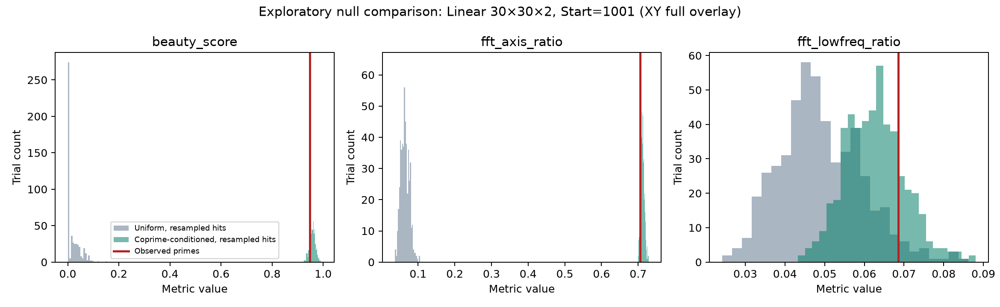

# Prime Grid Atlas — Scientific Audit

[Italian original](SCIENTIFIC_AUDIT.it.md)

This is the English translation of the original audit. Results and findings describe that audit snapshot; translation does not constitute a new experimental run. The archived manifest retains the source hashes from that run: the later translation of comments and docstrings in `metrics.py` changes its file hash but leaves executable logic unchanged.

> **Pre-release status note:** subsequent v1.0.0 release preparation resolved
> H1 (spectral-entropy reflection instability), the int64 part of M7, the
> cached-limit part of M8, and the invalid-plane/nonpositive-trial cases in L2.
> One-dimensional nonconstant FFT fields are now evaluated. The historical
> experiments and values below preserve the former metric definition and have
> not been relabelled; see [RESEARCH.md](RESEARCH.md) and
> [RESEARCH_FINDINGS.md](RESEARCH_FINDINGS.md) for current behavior.

## Executive summary

Scientific audit of code v1.0.0, subsequent to and separate from editorial preparation. **The Linear mapping, slices, accumulations, arithmetic steps, prime masks and verified arithmetic functions match the definitions reconstructed from the code. This does not validate strong interpretations of the patterns.**

**One Critical finding** was reproduced and fixed: the CPU scalar FFT modified cached arithmetic fields. **3 High**, **8 Medium**, **3 Low** and **3 Informational** findings remain. Classification concerns the impact described; it does not classify every limitation as an algorithmic error.

The complete suite runs **67 tests: 63 passed, 3 documented expected failures, 1 skipped because CUDA was unavailable, 0 unexpected failures**. Before the fix, the new FFT integrity test failed in four subcases. Expected failures remain open issues; they are not counted as correct components.

The separate script runs 500 trials for each of three null models on Linear 30×30×2, Start=1001, as well as synthetic matrices, 250 Bernoulli samples, and comparisons of aspect ratios, symmetries, placements and Start/Z. The observed FFT peak, extreme against the uniform null, matches **all** samples conditioned on coprimality: here the maximum peak is exactly explained by parity and the embedding, without invoking a new property of primes.

**Only application-code change during this audit:** a private buffer in `atlas_engine.fft_spectrum` before scalar centering. No changes to FFT definitions, entropies, coefficients, baselines, scoring, primality or placements. Editorial and export changes from the preceding task were already present and are not attributed to this audit.

## Mathematical model verified

### 1. Linear volume and axes

`atlas_engine.build_volume` constructs `arange(X*Y*Z, dtype=int64) + Start` and applies `reshape(Z,Y,X)` in C order. Thus, in zero-based coordinates:

$$n(x,y,z)=Start+x+Xy+XYz.$$

For X=3, Y=2, Z=3, Start=1, the explicit values produced and verified are:

```text
z = 0       z = 1        z = 2
1  2  3     7  8  9      13 14 15
4  5  6     10 11 12     16 17 18
```

Matrix columns are x, rows are y and the outer index is z. C-order flattening gives 1,…,18. Without overflow, the minimum is Start and the maximum is Start+XYZ−1; cardinality XYZ, no duplicates or gaps. A negative Start includes negative integers, does not change orientation and does not make them prime.

Subtracting the formula at adjacent coordinates gives Δx=1, Δy=X and Δz=XY. Tests verify these increments directly on arrays and the value of every cell, not just the reshape.

### 2. Slices, accumulations and `_base_and_step`

`grid_model.get_plane_data` returns a number slice, a selection slice and cumulative hit counts simultaneously. The `overlay` parameter determines which field the caller uses and the value of `visible_depth`; **the `hits` field is computed cumulatively even with overlay=False**. It is neither a max projection nor an implicit average.

| Plane | Columns / rows | Excluded axis | Slice at depth k | Cumulative hits | Base b | Step s |
|---|---|---|---|---|---|---|
| XY | x / y | z | n[k,:,:] | sum of selection over z=0,…,k | Start+x+Xy | XY |
| XZ | x / z | y | n[:,k,:] | sum of selection over y=0,…,k | Start+x+XYz | X |
| YZ | y / z | x | n[:,:,k] | sum of selection over x=0,…,k | Start+Xy+XYz | 1 |

Flattened bases follow the same order as hits: no incorrect transposition was found. `projection` clamps k to [0,depth_limit−1]; None selects the last level. Direct use of `get_plane_data` does not apply the upper limit. The API treats unrecognized planes as YZ; the GUI offers only the three valid values.

For one cell, $h_k=\sum_{j=0}^k I(b+js)$; `alive` means $h_k>0$. In XY, accumulation for the previous example is:

```text
hits z=0..2          coprime(base,6)
2 1 1               1 0 0
0 3 0               0 1 0
```

Alive density is 4/6, not 7/18 (prime density in the volume). The normalized hit view divides by k+1; the selection FFT uses only alive. The proposed precise terminology is “slice” or “cumulative selected-count map”; “step” is the **arithmetic increment along the accumulated axis**, not geometric distance between pixels.

### 3. Prime masks and families

`number_theory.prime_mask_for_values` uses a full sieve from 0 through the maximum valid value **inclusive**, then indexes the sieve. Values <2 are false; 2 is true; even values above 2 are false. The cache reuses a larger sieve for smaller nonnegative requests. Intervals 1…100 and 1…1000 give 25 and 168 primes; −30…30, 97…149, 1001…1100 and square boundaries are also compared with independent integer trial division.

| Mode | Reconstructed criterion |
|---|---|
| Primes | p≥2, no proper divisor >1 |
| Twin primes | p prime and p+2 prime; selects the lower member |
| Sophie Germain primes | p prime and 2p+1 prime |
| Safe primes | p prime, p>2 and (p−1)//2 prime |

Floor division in Safe mode does not alter the criterion for odd prime p; 2 is explicitly excluded. Partners are tested even outside the volume: a one-cell volume containing 11 selects Twin and Sophie Germain; 23 selects Safe. These are not counts of pairs entirely contained in the sample.

Scalar `is_prime` uses division by odd numbers up to `int(sqrt(n))+1`; the main path uses the sieve and `isqrt`. Correctness of the scalar helper for arbitrarily large integers is not certified by comparison restricted to small intervals.

### 4. Arithmetic functions and conventions

The independent oracle enumerates divisors and factors; μ is also verified using the recurrence μ(1)=1 and $\mu(n)=-\sum_{d\mid n,d<n}\mu(d)$. The ratio φ(n)/n is compared with direct counting of coprimes in 1,…,n. The code exposes no separate φ function: it returns `euler_phi_ratio`.

| n | Factors | φ | φ/n | ω | τ | μ |
| --- | --- | --- | --- | --- | --- | --- |
| 1 | 1 | 1 | 1 | 0 | 1 | 1 |
| 2 | 2 | 1 | 0.5 | 1 | 2 | -1 |
| 4 | 2^2 | 2 | 0.5 | 1 | 3 | 0 |
| 6 | 2 * 3 | 2 | 0.333333 | 2 | 4 | 1 |
| 8 | 2^3 | 4 | 0.5 | 1 | 4 | 0 |
| 12 | 2^2 * 3 | 4 | 0.333333 | 2 | 6 | 0 |
| 30 | 2 * 3 * 5 | 8 | 0.266667 | 3 | 8 | -1 |
| 36 | 2^2 * 3^2 | 12 | 0.333333 | 2 | 9 | 0 |
| 60 | 2^2 * 3 * 5 | 16 | 0.266667 | 3 | 12 | 0 |
| 210 | 2 * 3 * 5 * 7 | 48 | 0.228571 | 4 | 16 | 1 |

For n=1, φ=τ=μ=1 and ω=0. Square-free includes 1; semiprime requires two prime factors **with multiplicity**, hence includes p²; prime power includes p¹. For n≤0, τ and μ return 0 and the three preceding selections are false. Factorization and ω use |n|, with empty factorization for 0,±1; `phi_ratio(n≤0)` forces n=1 and returns 1. These are software conventions outside the positive domain, not canonical theoretical extensions.

GCD uses |n| and N=max(1,|param|); residues and multiples likewise normalize the parameter to a positive modulus of at least 1. A zero parameter means modulus/divisor 1, not GCD(n,0). Residues and GCD keep all cells selected; τ selects n>0; μ selects μ(n)≠0. Scalar fields remain values of the current slice even with accumulation enabled.

### 5. Coprime mask, density and exceptions

The baseline is $C(b)=\mathbf1_{\gcd(b,s)=1}$. The identity $\gcd(b+js,s)=\gcd(b,s)$ proves that using the base or any term of the progression is equivalent. In XY s=M=XY; in XZ s=X; in YZ s=1.

If d=gcd(b,s)>1, d divides every term. A prime term can therefore only be d itself, and only if d is prime. For M=30, 2,3,5 can be alive primes **outside** the coprime mask. The correct statement is “every prime p that does not divide M is coprime to M”, not “all primes are coprime to M”.

For arbitrarily large primes, coprimality is necessary. Sufficiency for infinitely many primes in an integer progression with positive step is a classical result of Dirichlet, not a result of this software; it provides no guarantee at finite depth. See the [MIT notes on primes in arithmetic progressions](https://math.mit.edu/classes/18.785/2015fa/LectureNotes17.pdf).

XY bases cover M consecutive integers: any Start gives **exactly** φ(M)/M. In XZ each row along x covers a full period X; in YZ s=1 and density is 1. For these complete projections there is no boundary discrepancy: theoretical error is zero apart from floating-point rounding. M=6 gives 2/6; M=30 gives 8/30, with residues {1,7,11,13,17,19,23,29}. An arbitrary crop of cells, unlike the implemented full projection, could differ.

Cases 5×6, 3×10 and 2×15 with the same Start,Z have identical counts ordered by residue modulo 30. The 2D arrangement changes, and local entropy, edges and FFT may change. Even for identical M, the arithmetic effect of the modulus must be separated from the geometric choice of factors X,Y.

### 6. Random baseline and reproducibility

For each trial, `random_baseline_metrics_for_hits`:

1. computes K, the number of observed positive hits;
2. selects K distinct positions over the whole grid, without replacement;
3. draws K values from the positive-hit vector **with replacement**;
4. computes the metrics and returns their arithmetic means.

The baseline preserves dimensions and alive-cell count exactly; positive hits are preserved in distribution, not sample by sample. Total hits and the histogram can change. It is not conditioned on the coprime mask and does not preserve arithmetic dependencies or correlations. If K=0 it returns zero metrics directly, without generating trials. The “Seeded random” placement seed controls something else: it permutes integer positions and is not the statistical hit baseline.

The derived seed is the XOR combination of X·73856093, Y·19349663, Z·83492791, Start·2654435761, plane code·1000003 and placement code, reduced to 32 bits. It does not use Python `hash()`. A `baseline_seed>=0` overrides the derived seed; the RNG still applies `& 0xFFFFFFFF`. Distinct seeds can collide, particularly those congruent modulo 2³².

The RNG is local, `np.random.default_rng`; no global NumPy or CuPy RNG enters the baseline. Repeatability after perturbing the global RNG and identity between two processes with different PYTHONHASHSEED values are verified. Dictionaries do not determine draw order. Full Z enters the seed even for partial overlays; mode, depth and scientific parameters must still be fixed to reproduce metrics. Equal seeds without an equal environment are not a universal guarantee: the [NumPy policy](https://numpy.org/doc/stable/reference/random/compatibility.html) limits stream compatibility to its documented conditions.

### 7. Entropies, edges and gradients

All implemented entropies derive from Shannon entropy, using base-2 logarithms; their domains, quantization and normalization differ.

| Field | Distribution | Normalization / range |
|---|---|---|
| global_entropy | Exact frequencies of hit values, including 0 | Unnormalized; 0≤H≤log2(min(N,d+1)) for hits from 0 to d |
| local_entropy_mean | Mean entropy of 3×3 windows | Unnormalized; 0≤H≤log2(min(B,9)); with B=8, discrete maximum log2(9)−2/9≈2.9477 |
| fft_spectral_entropy | Non-DC powers normalized by their sum | Entropy / log2(number of strictly positive powers), nominally [0,1]; issue H1 |

Local binning uses the **global field** minimum and maximum: `floor((v−min)/(max−min)*B)`, clamped to 0,…,B−1, with B=8 by default. Constant fields are quantized to zero. Padding replicates boundary cells; there are nine observations even at corners. Zero probabilities contribute nothing (0 log 0=0). A constant matrix has Hloc=0; a binary 3×3 checkerboard gives H(4/9,5/9)≈0.991076. Multivalued noise can have higher local entropy; binary noise is not necessarily more entropic than a local checkerboard.

`edge_density` does not use gradients: it is the fraction of cells with $H_{loc}\ge H_{min}+r(H_{max}-H_{min})$, r=0.72. If Hmax=Hmin, it returns zero. A regular checkerboard thus has edges=0 despite its visually high contrast. A single point creates a local region of high entropy. The proposed descriptive name is “high-local-entropy fraction”.

Gradients are a separate view: centered differences in the interior, one-sided differences at boundaries; zero component on a singleton axis; Euclidean norm of the two components. A field 3x+4y+10 returns 5 even at boundaries. It is not normalized by dimensions or physical units.

### 8. FFT and actual definitions

For a matrix with H rows and W columns, input f is binary alive for selections/overlays and the scalar field for residues, τ, μ and GCD in the FFT view. Center g=f−mean(f), compute an unnormalized FFT2, apply fftshift and use $P=|F|^2$. The central DC component is explicitly zeroed. Centering makes the sum of g zero in exact arithmetic; the DC reset removes that component's numerical residual. No window, additional detrending or zero padding is applied.

With T=ΣP, c=(floor(H/2),floor(W/2)), $q=P/T$:

$$peak=\max(P)/T,$$
$$axis=\frac{\sum_{i=c_y\ \mathrm{or}\ j=c_x,(i,j)\ne c} P_{ij}}T,$$
$$low=\frac{\sum_{0<r_{ij}\le\max(1,\alpha r_{max})}P_{ij}}T,\qquad \alpha=0.18,$$
$$H_{spec}=\frac{-\sum_{P_{ij}>0}q_{ij}\log_2q_{ij}}{\log_2 K_+}.$$

K+ is the number of strictly positive powers; Hspec=0 if K+≤1. The three fractions are nominally [0,1] (small floating-point excursions are possible). For T=0, zeros are returned. W≤1 or H≤1 also produces zero metrics, **although `fft_spectrum` can display nonzero power for a row**. The metrics function returns zeros for empty arrays and zero dimensions, and likewise for insufficient samples. FFT2 does not define the display function on truly empty shapes, but the GUI cannot construct empty volumes.

The display saves `log1p(P)`; ratios are not computed on that logarithm. Raw powers depend on cardinality, density and amplitude; ratios cancel a global multiplicative factor, not every confounder.

The DFT is verified with complex exponential sums independent of `np.fft`; fractions are compared with direct power sums. General library conventions: [NumPy FFT](https://numpy.org/doc/stable/reference/routines.fft.html). This source describes the library; the specific score definitions are reconstructed from the code.

**Axis bias.** Masks are one row and one column, not bands of normalized width. They contain H+W−2 non-DC bins out of HW−1. For a single pixel, power is flat and axis=(H+W−2)/(HW−1), exactly. Vertical/horizontal stripes give axis=1; the alternating checkerboard gives axis=0. Periodic diagonals can have power off the axes. This is not a general measure of “order”.

**Low-frequency.** r is measured in FFT indices, not normalized frequencies; $r_{max}=\sqrt{\lfloor H/2\rfloor^2+\lfloor W/2\rfloor^2}$. It is proportional to the distance from the center to the farthest corner, with a minimum radius of 1 bin. A ball in index coordinates is not a ball in frequencies per cell when H≠W; the discrete number of included bins also changes. Exact matrix transposition preserves the radius geometry, but reshaping identical values into different shapes does not.

### 9. Beauty, structural, deltas and residuals

$$B=\max(0,R_c-R_n)(1+0.35H_{loc}+0.65E)e^{-18(\rho-0.27)^2}.$$

The five coefficients/targets are configurable. R_c,R_n are alive fractions inside the two masks; ρ is projected alive density. This is a **heuristic score**, not an invariant or a probability. With default settings B≥0 and B≤2.7 is a conservative upper bound, not necessarily attainable. It increases with Hloc/E at fixed contrast and density and with nonnegative weights; the density factor peaks at 0.27 and decreases away from it. Changing density also changes the other terms, so there is no global monotonicity. All-zero or all-one fields have B=0 for M>1 with both classes present. For s=1 there is no noncoprime class: R_n is set to zero and the score is not comparable to usual cases.

`structural_score = B_observed − mean(B_random)`. It can be negative and can exceed 1; it is not a p-value, z-score or probability. The name “structural” risks suggesting that the modular component has been removed: the uniform baseline does not do this.

For the seven keys Hloc, edge, Hglobal and four FFT metrics:

- `random_*`: trial mean of the same metric;
- `delta_*`: observed−random;
- `coprime_mask_*`: metric of the binary coprime mask;
- `delta_coprime_*`: observed−coprime_mask.

There is also `random_beauty_score`; its corresponding difference is called structural_score. Density has a separate coprime difference. Tests fix the sign convention for each key.

**L1 and L2 do not compare matrices pixel by pixel.** They compare the vector of seven coprime deltas: $L1=\sum|\Delta_i|$, $L2=\sqrt{\sum\Delta_i^2}$. There is no standardization, covariance estimation or density compensation. Density is not included in that vector. A change in entropy bits carries a different weight from a small FFT fraction. Identical formulas do not ensure comparability across X/Y, Z or Start.

### 10. Scan, Z, Start and sampling

`qt_app.ScanWorker.run` visits every integer between the minimum and maximum of both endpoints, inclusive; y is the outer loop. It always constructs Primes/Linear, with the specified Start, fixed Z and full depth for the selected plane. It computes metrics for each pair without aggregating pairs of equal product, then sorts by descending structural_score. Export: 58 columns (the actual step exists in the engine but not in the CSV), 22 selectable heatmap metrics. Reversed intervals are tested; (2,15),(3,10),(5,6) remain three distinct rows for M=30.

Increasing Z in XY adds terms to the same progressions and can increase hits and saturate alive; alive density is monotonic for fixed Start,X,Y, but H/FFT/beauty need not be. Hglob and Hloc use unnormalized hits in the scan, with relative binning for Hloc; FFT support is binarized and loses multiplicity. No complete normalization makes different Z values statistically equivalent. For a fixed modulus, eventual activation of all coprime classes is consistent with the cited classical result, not a new organization of primes; noncoprime exceptions present in early layers remain in the overlay.

In XZ/YZ, accumulated depth is Y/X, whereas Z changes the number of displayed rows. Thus “Z = depth” does not automatically transfer to these planes.

Start shifts the classes assigned to pixels. Start→Start+M preserves the XY mask exactly but selects another window along each progression; counts can change. Arbitrary Start preserves full coprime density but not its arrangement. Prime density and small-prime effects change with the interval; **no comparison with 1/log(n) is implemented**. A prime-like model incorporating this remains a future control, with appropriate handling of small n.

### 11. Placements: all implementations

Tests cover **1,372 volumes**: 14 placements × 49 rectangles X,Y∈1,…,7 × two Start values, Z=3; plus prime modes and comparisons on larger grids. Each tested volume is a complete permutation of the Linear interval. This is extensive finite verification, not certification for arbitrary dimensions or overflow.

| Placement | Reconstruction / parameter |
|---|---|
| Linear | C order, x fastest, then y,z |
| Spiral inward | Clockwise rectangular boundaries, outside→inside |
| Spiral outward (Ulam) | Spiral from the conventional center ((X−1)//2,(Y−1)//2), clipped to the rectangle |
| Boustrophedon | Alternating left/right rows |
| Hilbert curve | Traversal of a virtual square with power-of-2 side; discards outside coordinates |
| Morton Z-order | Sorting by interleaved x,y bits |
| Diagonal zigzag | Alternating directions along constant x+y diagonals |
| Corner expanding rings | Rectangular shells growing from corner (0,0) |
| Concentric rings | Boundaries from outside inward, alternating direction between rings |
| Radial spokes | Discrete rays using GCD-reduced direction; ordered by angle and distance |
| Prime modulus weave | First-plane values ordered by residue n mod max(1,abs(param)), then value |
| Seeded random | Local XY permutation from a seed combined with X,Y, reused across levels |
| Bit reversal | Linear indices sorted by bit reversal |
| 3D helix | Spiral inward rotated by z%4 on squares; four reflections/orientations on rectangles |

All fixed planar placements repeat the same offsets +zXY: they preserve the vertical XY progression while changing progressions along x/y. Helix can also change the vertical progression. Clipped Hilbert does not guarantee unit-distance continuity after discarding virtual-square cells. Weave orders the first layer by residue: if its parameter does not divide XY, later layers undergo a cyclic residue shift and do not necessarily restart at 0.

The GUI comparison preserves X,Y,Z,Start,mode,parameter,placement_param,plane,depth,overlay; only the placement name changes. The whole volume contains the same set of integers and primes. A slice or partial overlay on a plane other than XY can, however, select a different subset: “same volume sample” does not mean “same observed cells in the slice”. `distance_from_linear` is the unstandardized norm of eight metrics (the seven plus density). All are computed on selection/hits even for scalar modes.

### 12. Cartesian rendering and Prime Star Atlas

`np.nonzero(selected)` returns z,y,x; the renderer forms `column_stack((x,y,z))`: Cartesian orientation is verified against the integers. It does not center or translate scientific data; it centers the camera. “Selected only” filters points; when all points are shown, color distinguishes selection. The configurable two-million-point cap samples equally spaced indices in the flattened list: this can introduce visual aliasing but does not enter engine metrics.

For positive X,Y, spherical rendering computes:

$$\theta=2\pi(x+0.5)/X+z\,rotation\,\pi/180,$$
$$h=1-2(y+0.5)/Y,\qquad R=\max(0.1,R_0)+z\max(0.01,spacing),$$
$$(u,v,w)=R(\sqrt{1-h^2}\cos\theta,\sqrt{1-h^2}\sin\theta,h).$$

h is clamped to [−1,1] for safety. No point lies exactly at a pole for valid indices; each angular cell bounded by Δθ=2π/X and Δh=2/Y has area **4πR²/(XY)**. This is sampling by equal-area cells, not a grid of uniform geodesic distances or an isotropic distribution without lattice structure. Density per unit area decreases as 1/R² across shells with equal point counts. Selected primes are not uniform by construction. Rotation changes the radial direction of the same column between layers; only nonrotating shells keep columns along the same direction.

Calculations use float64; output positions use float32. Radii, rotations, absence of duplicates in the tested case and cell areas are verified; interactive OpenGL and actual camera position were not validated on a physical display. FFT remains on the rectangular map: there is no spherical harmonic analysis.

### 13. Precision and limits

Volume integers are int64. A necessary condition is that Start and Start+XYZ−1 lie in [−2⁶³,2⁶³−1]; family partners n+2,2n+1,n−1 must also be representable. The code does not validate these ranges; M7 provides a wraparound example. The sieve allocates memory proportional to the maximum integer, not interval width, so enormous Start values become impractical long before int64 limits. No benchmark establishes a universal RAM/time maximum.

With default GUI limits Start≤999999 and XYZ≤25,000,000, nmax≤25,999,998 and the Sophie Germain partner≤51,999,997: far below int64 and 2⁵³. The GUI limits each dimension to 9999, so projection hits are ≤9999 and safe in int32. The headless API and configurations beyond these limits are not equivalent: `hits` are converted/summed in int32 and can overflow; float64 scalar values lose unit precision beyond 2⁵³. Scores use float64; float32 3D positions are for rendering only.

Invalid dimensions are rejected when building the volume; the cache can bypass a subsequently lowered limit (M8). NaN/Inf inputs lack general finite-value validation: for example, `AppConfig(beauty_entropy_weight=inf)` is accepted and can produce NaN even on a small volume. Standard JSON disallows Infinity, but the Python parser used accepts it; explicit validation is recommended.

## Tests performed

### Deterministic suite and oracles

| File | Checks |
|---|---|
| tests/scientific_reference.py | Independent oracles: trial division, factors, Shannon entropy using Counter, enumerated windows, DFT using complex sums |
| tests/test_linear_embedding.py | Complete example, interval, offsets, increments, axes and invalid dimensions |
| tests/test_number_theory.py | Primes, families, boundaries, φ/ω/τ/μ, factors and GCD/residue modes |
| tests/test_projections.py | Every level of small cases and all three planes; slice/hit/base/step and scalar overlay |
| tests/test_coprime_mask.py | Small cases, exact density, M=30, exceptional primes and Start shifts |
| tests/test_random_baseline.py | Sampling, K preservation, hit resampling, means, seeds across processes, signs and norms |
| tests/test_metrics.py | Independent entropies, edges, affine gradient, beauty and bounds |
| tests/test_fft_metrics.py | Cache regression, independent DFT, ratios, DC, sinusoid, periodicity, impulse and degeneracies |
| tests/test_placements.py | 1,372 permutations, arithmetic/geometric invariants, parameters and spherical transform |
| tests/test_backend.py | CPU fallback with absent GPU and injected failure; conditional hardware test |
| tests/test_scientific_ui.py | Actual scan worker with reversed intervals, equal M, sorting; comparison configuration |
| tests/test_known_scientific_issues.py | Three open expectations marked expectedFailure: Hspec symmetry, int64 overflow and cache/limit |

The 21 pre-existing tests are also included. Oracles do not import production arithmetic functions to calculate expected values. An initial attempt to reconstruct the RNG stream in a test evaluated Python assignment in the wrong order (RHS before index): the test was corrected by separating position/value draws; this was not an engine defect.

Verified environment: Python 3.14.7, NumPy 2.5.3, PySide6 6.11.2, Linux. CUDA/CuPy was absent in the test environment; hardware equivalence was **not verified**. The hardware test explicitly checks for silent fallback. Simulated fallback checks primality, GCD and local entropy; it does not certify every GPU kernel. Auto thresholds change the backend, not the intended formula, but H1 sensitivity makes a real comparison of spectral metrics particularly important.

### Synthetic matrices

24×24 grids, seed 20260910. The sinusoid uses periodic integer values [2,3,2,1], a scalar field for FFT; all other FFTs are binary. Beauty uses artificial bases 1,…,576 and step=576: it is not an intrinsic matrix property and is not interpreted as one. The complete table including density and beauty is in [synthetic_metrics.csv](docs/scientific_audit/synthetic_metrics.csv).

| Field | Hlocal | Hglobal | Edge | Peak | Axis | Low | Hspec |
| --- | --- | --- | --- | --- | --- | --- | --- |
| all_zeros | 0 | 0 | 0 | 0 | 0 | 0 | 0 |
| all_ones | 0 | 0 | 0 | 0 | 0 | 0 | 0 |
| single_point | 0.00786341 | 0.0184225 | 0.015625 | 0.00173913 | 0.08 | 0.0486957 | 1 |
| checkerboard | 0.991076 | 1 | 0 | 1 | 0 | 0 | 3.70418e-31 |
| vertical_stripes | 0.841771 | 1 | 0.916667 | 0.5 | 1 | 5.13581e-34 | 0.430677 |
| horizontal_stripes | 0.841771 | 1 | 0.916667 | 0.5 | 1 | 9.13033e-34 | 0.5 |
| diagonal_stripes | 0.983882 | 1 | 0.994792 | 0.5 | 0 | 7.03375e-67 | 0.278943 |
| random_Bernoulli | 0.809188 | 0.890022 | 0.836806 | 0.010215 | 0.0622743 | 0.0328858 | 0.935855 |
| periodic_sinusoid | 1.22385 | 1.5 | 0.458333 | 0.5 | 1 | 5.13581e-34 | 0.430677 |
| single_line | 0.114787 | 0.249882 | 0.125 | 0.0434783 | 1 | 0.26087 | 1 |

Near-zero powers are rounding effects. Vertical and horizontal stripes of the same period have identical peak and axis values but different Hspec because of H1. High local entropy and high edge density are not synonymous; the checkerboard is an explicit counterexample.

### Full null comparison and conditioned control

Fixed configuration: X=30,Y=30,Z=2,Start=1001,Primes,Linear,full XY; seed 20260910, 500 trials per model. 900 cells, 240 admissible, 181 alive. No prime divisor of M=900 lies in the interval: no exceptions need to be discarded.

- **Uniform resampled:** exactly the current baseline; means verified against the application function.
- **Coprime-conditioned resampled:** same alive count and same hit resampling, but positions restricted to the 240 admissible cells.
- **Coprime-conditioned exact hits:** same restriction and an exact permutation of the positive-hit vector. This exists only in a separate experimental script.

The table reports sample standard deviation and the observed midrank percentile; the tail fraction is an inclusive empirical count, **not a formal p-value**. Ties are evaluated with `isclose` rtol=atol=1e−12 to avoid interpreting roundoff as ordering. For degenerate distributions the percentile is 50 and both tails are 1. A tail of 0/500 does not mean zero probability: observed resolution is 1/500. q2.5/q97.5 in the CSVs are trial quantiles, not confidence intervals for the result.

| Null | Metric | Observed | Mean | SD | Percentile | Tail ≥ observed |
| --- | --- | --- | --- | --- | --- | --- |
| uniform_resampled | local_entropy_mean | 0.654704 | 0.713851 | 0.00979903 | 0 | 1 |
| uniform_resampled | fft_peak_ratio | 0.251739 | 0.00743458 | 0.00147152 | 100 | 0 |
| uniform_resampled | fft_axis_ratio | 0.704923 | 0.0643383 | 0.0116249 | 100 | 0 |
| uniform_resampled | beauty_score | 0.9481 | 0.0183169 | 0.0252702 | 100 | 0 |
| coprime_conditioned_resampled | local_entropy_mean | 0.654704 | 0.652102 | 0.00976076 | 58.6 | 0.414 |
| coprime_conditioned_resampled | fft_peak_ratio | 0.251739 | 0.251739 | 4.0984e-17 | 50 | 1 |
| coprime_conditioned_resampled | fft_axis_ratio | 0.704923 | 0.711371 | 0.00495165 | 8.1 | 0.934 |
| coprime_conditioned_resampled | beauty_score | 0.9481 | 0.958304 | 0.0117065 | 20.4 | 0.796 |
| coprime_conditioned_exact_hits | local_entropy_mean | 0.654704 | 0.652791 | 0.00724483 | 60 | 0.4 |
| coprime_conditioned_exact_hits | fft_peak_ratio | 0.251739 | 0.251739 | 4.18783e-17 | 50 | 1 |
| coprime_conditioned_exact_hits | fft_axis_ratio | 0.704923 | 0.710825 | 0.00504755 | 10 | 0.91 |
| coprime_conditioned_exact_hits | beauty_score | 0.9481 | 0.959009 | 0.00941144 | 12.6 | 0.874 |

[Full distributions](docs/scientific_audit/null_trials.csv), [summary of all metrics](docs/scientific_audit/null_summary.csv), [primes and coprime mask](docs/scientific_audit/null_controls.csv).



**Exact explanation of the peak in this case.** Start is odd and X=30 is even: every integer coprime to 900 has even x. Any binary occupancy of K=181 cells on that support gives an x-axis Nyquist coefficient of magnitude K. Every non-DC coefficient has magnitude ≤K by the triangle inequality. Parseval for the unnormalized FFT of the centered field gives T=NK−K²=K(N−K). Therefore **peak=K/(N−K)=181/719≈0.251738526** for all these occupancies, not only primes. Centering does not change the Nyquist coefficient because alternating signs sum to zero over the plane.

The large difference from the uniform null therefore does not isolate residual prime organization. Observed beauty 0.9481 against uniform mean 0.01832 produces an exploratory structural score ≈0.92978 (with 500 trials); against the resampled coprime control, the beauty difference is about −0.01020. Hspec remains sensitive to the controls and defect H1; tails of 0.038/0.07 do not justify discovery claims, also considering the selection of multiple metrics and a single sample.

### Dependence on density

50 Bernoulli replicates of 32×32 per nominal density; the same uniform draws are reused across densities for paired comparisons. Descriptive means, not an inferential study:

| ρ target | ρ mean | Hglobal | Hlocal | Edge | Axis | Hspec |
| --- | --- | --- | --- | --- | --- | --- |
| 0.05 | 0.0494141 | 0.283116 | 0.199764 | 0.079375 | 0.0612442 | 0.939585 |
| 0.1 | 0.0996875 | 0.467332 | 0.370107 | 0.227168 | 0.0609414 | 0.938678 |
| 0.2 | 0.199805 | 0.720928 | 0.622299 | 0.563066 | 0.0603789 | 0.939011 |
| 0.3 | 0.300391 | 0.881294 | 0.784832 | 0.794922 | 0.0590432 | 0.939413 |
| 0.5 | 0.502285 | 0.999189 | 0.905234 | 0.949258 | 0.0591112 | 0.93937 |

Binary Hglobal follows the known occupancy dependence; Hlocal and edges change strongly. In this experiment FFT ratios change much less, but this is not a theorem of density independence. The application's uniform null controls K exactly, whereas direct comparison with the coprime mask does not match density. [Full trials](docs/scientific_audit/density_trials.csv).

### Aspect ratio and symmetries

50 samples of the same 300-cell binary vector: reshapes 10×30 and 15×20, plus their **true transposes** 30×10 and 20×15. Density and histogram remain equal. To distinguish reshaping from transposition, four independent samples were not generated.

| X | Y | Axis flat power | Hlocal | Edge | Axis mean | Low mean |
| --- | --- | --- | --- | --- | --- | --- |
| 10 | 30 | 0.12709 | 0.789661 | 0.804 | 0.12734 | 0.0818666 |
| 15 | 20 | 0.110368 | 0.792482 | 0.807267 | 0.10423 | 0.0388673 |
| 20 | 15 | 0.110368 | 0.792482 | 0.807267 | 0.10423 | 0.0388673 |
| 30 | 10 | 0.12709 | 0.789661 | 0.804 | 0.12734 | 0.0818666 |

Differences in low and axis fractions are substantial even at identical density/cardinality. Transposition preserves Hlocal/edges and the principal ratios within roundoff; Hspec can fail on sparse spectra.

In the periodic diagonal 9×12 test, reflection leaves all expected geometric indicators unchanged but changes K+ from 2 to 4 and Hspec from 1 to 0.5. A generic binary field instead has unchanged Hspec within numerical error. Tested symmetries are original, transpose, flip X, flip Y and 90° rotation. Beauty is not included in symmetry expectations when the base mask remains fixed: bases must also be transformed for that. [Symmetry table](docs/scientific_audit/symmetry_metrics.csv).

### Permutations, Start and Z

[placement_metrics.csv](docs/scientific_audit/placement_metrics.csv) compares 14 placements on the three planes, volume 15×20×4,Start=1001. Total prime count is unchanged. In XY, fixed planar placements permute entire column counts and preserve density/Hglobal, but generally change Hlocal/FFT. Helix and other planes can change which numbers overlap: the count histogram and density can also change without changing the volume's prime set.

[start_z_m30.csv](docs/scientific_audit/start_z_m30.csv) contains 100 configurations with (2,15),(3,10),(5,6),(6,5), Z=1,2,4,16,64 and Start=1,2,10,31,1001. It keeps volume density, projected density and geometric statistics separate. A result invariant under permutation of volume values is a property of the set; a local or spectral map metric is a property of the chosen field's embedding. Not every projection is simply a permutation of the same 2D field.

## Findings

### Critical

**C1 — The CPU scalar FFT corrupted the shared arithmetic field. FIXED.**

- File/function: `atlas_engine.py`, `fft_spectrum`, interaction with `build_scalar_field` and `projection`.
- Before: `values=np.asarray(mode_values,dtype=float)` and `work=np.asarray(values,dtype=float64)` shared memory; `work -= work.mean()` also modified the cache. A new projection without clearing returned centered values instead of residues, τ, μ or GCD.
- Reproduction: GridConfig(3,2,2,'Residues modulo N',5), slice XY0: [[1,2,3],[4,0,1]] became [[−5/6,1/6,7/6],[13/6,−11/6,−5/6]] after `fft_spectrum`. μ could lose zeros and change signs in rendering, and subsequent analysis depended on view order.
- Evidence: `test_scalar_fft_does_not_modify_arithmetic_field_or_cache` failed for all four modes (6/6 values changed in each subcase); [before/after evidence](docs/scientific_audit/scalar_fft_regression.md).
- Change: `xp.array(values,dtype=xp.float64,copy=True)` only for the scalar FFT buffer. Centered power remains as intended; arithmetic data are no longer altered. The binary branch already allocated a separate array; fallback uses `astype` with a copy.
- After: the test passes, two FFT calls produce the same spectrum and new projections retain exact values. Invalidate already contaminated sessions/caches by restarting the application; recheck scalar outputs produced after FFT with the previous version. This is not evidence of an error in binary prime scans.

### High

**H1 — Spectral entropy is not robust to numerically near-zero coefficients. OPEN.**

- File/function: `metrics.py`, `_fft2_structure_metrics`.
- Description: denominator log2(K+) also counts rounding powers, with no relative threshold. Negligible mass can change the denominator by order one.
- Reproduction: `a=((x+y)%3==0)` on 9×12; Hspec(a)=1, Hspec(fliplr(a))=0.5, K+=2→4. Dedicated expected failure; symmetry table.
- Impact: comparisons across placements, symmetries, dimensions and backends can attribute to the field a change caused by the FFT implementation. The issue propagates to deltas, residuals and distance_from_linear, not directly to beauty/structural, which do not use FFT.
- Proposal NOT applied: choose between fixed support HW−1 and effective support with an explicit relative tolerance; version the metric and recompute benchmarks. Simply clipping the value to [0,1] does not solve the problem.

**H2 — Structural score against a uniform null includes the modular structure one would like to separate. METHODOLOGICAL LIMITATION.**

- Files/functions: `metrics.py`, `random_baseline_metrics_for_hits` and `prime_grid_metrics`; `atlas_engine.overlay_metrics`.
- Reproduction: null 30×30×2,Start1001; peak=0.251739 against uniform mean 0.007435, but identical in all coprime-conditioned samples. Beauty 0.94810 against 0.01832 uniform and 0.95830 conditioned.
- Impact: a large structural score is not evidence of a residual component beyond coprimality; its Rc−Rn factor rewards precisely that constraint. The calculation matches the formula; the stronger inference does not follow.
- Proposal NOT applied to the engine: conditioned comparisons and exact-hit controls, explicit handling of exceptional primes; the separate script provides an experiment, not an automatic replacement.

**H3 — Scan ranking and multiple comparisons lack a null distribution for selection. METHODOLOGICAL LIMITATION.**

- Files/functions: `qt_app.ScanWorker.run`, sorting; `atlas_engine.overlay_metrics`.
- Reproduction: set a rectangle containing many pairs and report only rows with maximum structural scores; each row has a local random mean, not calibration against the maximum of the entire scan.
- Impact: selected extremes, correlations between pairs and searching across multiple metrics prevent interpreting ranking as significance. Software tests do not estimate a false-positive rate.
- Proposals NOT applied: simulate the entire selection process under the null, holdout/preregistration, appropriate permutation tests; FDR or Bonferroni only after constructing valid tests and defining the family. Bootstrap does not automatically remove selection bias or spatial dependence.

### Medium

**M1 — FFT ratios depend on cardinality/aspect ratio.** File/function: `metrics._fft2_structure_metrics`. Reproduction: a single pixel on 10×30 and 15×20 gives axis=38/299 versus 33/299; low depends on radius in bins. Impact: raw comparisons across shapes confound FFT-mask geometry and field structure. Proposal: shape-specific nulls, normalized frequencies and a preregistered band convention, without silently changing metrics.

**M2 — Multimetric residuals are unstandardized and coprime/observed fields are not homogeneous.** Files/functions: `atlas_engine.overlay_metrics`, `PlacementComparisonTab._complete_run`. Reproduction: compare the seven-delta vector across Z values in `start_z_m30.csv`; Hglobal varies with counts while binary FFT does not. Impact: L1/L2 measure neither image distance nor calibrated effect sizes. Proposal: per-metric analysis, standardization estimated from appropriate controls and covariance checks; retain old scores under a name/version if introducing an alternative.

**M3 — The analyzed field depends on view, accumulation and mode.** Files/functions: `atlas_engine.analysis_values`, `projection`, `placement_geometry_metrics`; `qt_app.render`. Reproduction: Primes without overlay + Heatmap/Local entropy uses integers, not a mask; GCD with overlay displays the slice's scalar field, whereas selected-only and placement comparison use masks. Impact: images with the same generic title can represent different quantities; positive τ/GCD/residues can produce degenerate selection comparisons. Proposal: explicitly identify “integer field”, “binary selection”, “hit counts” or “scalar slice” in UI and metadata before renaming/changing calculations.

**M4 — Relative edge threshold and boundary conditions.** Files/functions: `metrics.local_entropy_grid`, `entropy_edge_mask`, `gradient_magnitude_grid`. Reproduction: checkerboard Hloc≈0.991 but edge=0; periodic stripes have edge≈0.917; Bernoulli noise ranges from 0.079 to 0.949 as density changes. Impact: this is not geometric contour density; boundary replication and global range can dominate small samples. Proposal: a descriptive name, reporting threshold/range and sensitivity to crops/boundaries; any other operators should be separate metrics.

**M5 — XZ/YZ degeneracies and singleton dimensions.** Files/functions: `atlas_engine._base_and_step`, `overlay_metrics`, `metrics.fft2_structure_metrics`. Reproduction: YZ step1 has C≡1; FFT of [[0,1,0,1]] shows power but all metrics are zero. M=XY remains in the CSV even when step=X/1. Impact: zero may mean a metric was not computed, not absence of structure; planes do not share the same modular baseline. Proposal: validity flags, exported step, deliberate 1D handling or explicit exclusion from rankings.

**M6 — Partial normalizations do not neutralize finite sampling and density.** Files/functions: `atlas_engine.overlay_metrics`, `metrics.prime_grid_metrics`. Reproduction: Bernoulli table and Start/Z sweep; changing Z can saturate alive, Start+M preserves C but changes hits. Impact: the same raw score on different samples need not mean the same thing. Proposal: comparisons matched for shape, depth and density, multiple Start ranges and out-of-sample checks; separate arithmetic intensity models, not implicit additions.

**M7 — Overflow and extreme numerical inputs are not validated in the headless API.** Files/functions: `atlas_engine.build_volume`, `metrics.prime_grid_metrics`, `app_config.validate_config`. Reproduction without an enormous sieve: GridConfig(3,1,1,'Multiples of k',2,start=2**63−2) produces [9223372036854775806,9223372036854775807,−9223372036854775808]. Expected failure for the expected rejection; beauty weight=Inf can produce NaN. Impact: incorrect results for inputs outside the normal GUI domain, or numerically invalid profiles. Proposal: explicit guards on ranges and partners, finite values and hit limits; a segmented sieve could be a separate project. Not applied; no range extension is promised.

**M8 — Cache and global state require controlled use.** Files/functions: `atlas_engine.build_volume`, `app_config.set_config`, `compute_backend.configure_backend`, GUI worker/comparison. Reproduction: build 3×3×3, lower max_volume to 2 and request the same configuration: the cache returns the volume instead of rejecting it. Expected failure. Static analysis: scan and comparison on different tabs share backend/cache/configuration and have no global mutual exclusion; completion of one can re-enable Configuration while the other continues. Impact: a limit is not enforced in headless use; reproducibility of concurrent sessions is not guaranteed (the full race is not certified by the test). Proposal: immutable job snapshots, serialized analyses, explicit cache invalidation. Meanwhile, run analyses sequentially and call clear_volume_cache after headless changes to limits.

### Low

**L1 — Overly generic terminology and labels.** File: `qt_app.py`, labels “Structural score”, “Protocol-valid”, “Local entropy”, “3D helix”. Reproduction: placement comparison and scalar/overlay views. Impact: “Protocol-valid” only means Linear is accepted by the protocol, not statistical validation; rectangular helix uses reflections, not a continuous rigid rotation. Proposals: “Linear reference”, “beauty minus uniform-null mean”, field identification and “layer-oriented spiral”. No renaming applied. Code searches found no p-value, confidence or discovery attributed to scores; historical papers use stronger wording.

**L2 — Inconsistent conventions and invalid arguments.** Files/functions: `number_theory.euler_phi_ratio`, `prime_sieve_upto`, `atlas_engine.overlay_metrics`, plane helpers. Reproduction: phi_ratio(0)=1; random_trials=0 is exported as 0 but the routine runs at least one trial; unknown planes fall back to YZ; a negative sieve limit after cache population can trigger negative slicing. Impact: surprising headless behavior; the GUI prevents invalid trial/plane cases. Proposal: document domains and reject invalid API parameters; do not interpret these conventions as mathematics of negative integers.

**L3 — Incomplete export and rendering provenance.** Files/functions: `qt_app.save_png`, `save_fft`, `show_3d`, CSV/batch export. Reproduction: single PNG without a sidecar; max_3d_points subsamples indices; metadata records the requested backend, not necessarily the actual backend for every row. `export_max_side` is exposed in configuration but does not limit batch figures produced using figsize/dpi. Impact: images or CSVs alone do not reconstruct the entire session/rendering. Proposal: save analyzed field, step, commit, dependencies, actual backend and sampling; connect configuration to behavior or remove the promised limit. No export changes during this audit.

### Informational

**I1 — Fundamental formulas and masks verified.** Files/functions: volume, projections, number_theory and coprime mask. Reproduction: small-case suite and independent oracles. Impact: those operations can be described as implemented and verified within the tested domain. No correction recommended for these formulas.

**I2 — No 1/log(n) model or automatic inference.** Files/functions: `metrics.py`, `atlas_engine.py`, scan/UI. Reproduction: search of functions and statistical terms; the null uses empirical occupancy, not prime-like probabilities. Impact: do not attribute unimplemented assumptions to the control. Any such model must be specified as a new experiment.

**I3 — Equal-area spherical cells do not imply uniform distances or cosmological evidence.** File/function: `grid_model.spherical_shell_positions`. Reproduction: area 4πR²/(XY), excluded poles, varying surface density between shells. Impact: visual arrangement and colors add no arithmetic information; 3D is not certified on a real display. No change to the transform is proposed without a specific experimental question.

## Verified components

Positively verified: Linear formula and axis order; intervals and Start within the tested domain; slices and inclusive cumulative counts; base/step associations; prime masks and families over independent intervals; factors and positive arithmetic functions, including n=1; GCD identity and full coprime density; exceptions 2,3,5 for M=30; cardinality and algorithm of the current null; means, delta signs and norms; global/local entropy according to their definitions; edge threshold according to the code; DFT/power and the first three ratios on exact cases; finite permutations for every placement; GUI comparison parameters; inclusive scan and sorting; Cartesian coordinates and spherical formula; CPU fallback on tested paths; scalar-field integrity after the fix.

Not certified: new theorems, interpretations of old screenshots, inferential statistics, numerical compatibility on every dimension/platform, GPU hardware, interactive OpenGL, concurrent reproducibility or extreme inputs.

## Statistical limitations

The protocol partially separates arithmetic, embedding and finite sampling: it retains explicit arithmetic controls and allows permutations of the same volume, but the uniform null also removes modular support; the coprime mask does not match counts; projections can change the local sample. A residual is relative to a specific null and specific metrics, not the difference between “all known mathematics” and “new structure”.

Current random means contain no standard deviations, tails or multiple-testing corrections. Those in the script are exploratory for one chosen configuration, not validation of the whole scan. Scan rows are not assumed independent: intervals, numbers and derived seeds may share structure. Choosing a metric after seeing the data is another comparison. Empirical quantiles are not automatic confidence intervals.

Coprime-conditioned comparison is useful because it preserves admissibility; it does not automatically model all dependencies between primes, intensity varying with n, constellations or the joint hit distribution. If primes dividing M are present, they must be explicitly separated or fixed in the control, not silently removed. When every admissible cell is alive, the conditioned occupancy null can be degenerate: this describes model saturation, not exceptional order.

## Recommended next experiments

1. Decide on a robust Hspec definition, record the metric version and rerun symmetry, exact-spectrum and CPU/GPU tests.
2. Repeat uniform/conditioned/exact comparisons on disjoint Start intervals and preregistered depths and shapes; handle exceptional primes separately.
3. At equal M, compare all geometric factorizations and true transpositions; at equal shape, vary Start and controlled density.
4. Simulate the distribution of the whole scan's maximum under an appropriate null, including the same ranking and selection process.
5. Separate exploration and holdout; retain negative results. FDR/Bonferroni require calibrated test statistics; a spatial bootstrap requires explicit assumptions.
6. Export raw trials and the environment; validate GPU without accepting fallback as GPU success. Serialize numerical jobs or isolate state/configuration.
7. Measure sensitivity to boundaries, quantization, density and display before interpreting figures. Any FFT windows, standardized distances or prime-like nulls must be new, declared options.

All these methodological changes are **proposed, not applied to the application**. The two conditioned controls exist only in the audit script.

## Safe claims

- “The software constructs an explicit linear embedding of integers and analyzes slices and cumulative occupancy of the associated progressions.”
- “The coprime mask represents modular admissibility; prime divisors of the modulus are explicit exceptions.”
- “Metrics describe the chosen field and embedding; current random controls preserve alive-cell count and resample hits.”
- “In tested cases, placements preserve the volume's integer set but change the geometry of its representations.”
- “In the reported experiment, the maximum FFT peak is determined by parity support and density; it does not distinguish primes from conditioned occupancies.”
- “The project is an experimental mathematics tool with documented numerical and methodological limitations.”

## Claims to avoid

“A new law of primes”, “proof of hidden organization”, “a statistically significant anomaly” based only on ranking, “structural score measures nonrandomness”, “the L2 residual removes all modular structure”, “invariance across dimensions/placements/GPU”, “a sphere uniform in every sense”, “all primes are coprime to M”, “global entropy measures spatial arrangement”, “the baseline preserves the hit histogram exactly”, “FFT or 3D rendering proves a new arithmetic property”.

## Documentation versus code audit

| Claim/documentation | Code behavior | Match? | Notes |
|---|---|---|---|
| README/RESEARCH: Linear formula | arange+Start, reshape(Z,Y,X) | Yes | Outside-int64 range not validated |
| XY/XZ/YZ | Slice plus cumulative hit field | Yes, with terminology clarification | Not a single/automatic projection |
| Accumulate 0..k | Inclusive indicator sum | Yes | Scalar fields remain slices |
| Random baseline | Fixed K, positions without replacement, values with replacement | Yes in current README | Historical v1 paper suggests exact preservation: no |
| Coprime baseline | gcd(base,step)==1 | Yes | step XY/X/1, prime exceptions |
| Centered FFT and power | Centering, FFT2, shift, DC zero | Yes after C1 | Hspec has instability H1 |
| Module scan | Primes/Linear, fixed Z, every X/Y pair | Yes | Equal M does not merge geometries |
| 14 placements as permutations | Complete in tested cases | Yes within tested domain | Planar placements preserve z step=XY |
| Prime Star Atlas equal-area | Equal-area θ,h cells per shell | Yes with qualification | Not uniform distances; rotation changes radial directions |
| Optional GPU with fallback | Probe and CPU retry | Only fallback verified | Actual equivalence test skipped |
| Export with configuration | CSV/batch snapshots from preceding task | Partial | Single PNGs, actual backend/commit missing |
| export_max_side limit | UI/config field present, figures use figsize/dpi | No for batch figures | L3 |
| 30p protocol: future inferential tests | Not implemented in engine | Yes as a proposal | Do not describe as features |
| Historical paper: global entropy/spatial dispersion | Histogram entropy invariant under permutation | No | Archive, not current specification |

## Operational answers to the 14 final questions

1. **Declared XYZ mapping?** Yes, zero-based Linear, layout (Z,Y,X), within the supported range.
2. **Projections?** Slices plus cumulative counts; the view selects the field, not a generic automatic projection.
3. **Overlay steps?** Yes for Linear: XY→XY, XZ→X, YZ→1; not indiscriminately transferable to all placements.
4. **Coprime baseline?** Yes as an admissibility mask; not a finite prediction of primes.
5. **Random properties?** Exact K; histogram/total hits resampled, not exact; unconditioned support.
6. **Correct entropy/edge/FFT?** Hlocal/Hglobal/edge formulas and power verified; C1 fixed; Hspec has a serious open instability and singleton cases are degenerate.
7. **Comparability across dimensions?** Only with declared controls and conventions; no general equivalence of raw scores.
8. **Structural score?** A beauty difference against a uniform null, not significance or a prime-specific component.
9. **Scan bias?** Yes: maximum selection, multiple metrics, correlated shapes and samples; no automatic correction.
10. **Placements are permutations?** Yes in the 1,372 tested volumes; projections can change aggregation even with the same volume.
11. **CPU/GPU equivalent?** Not demonstrated in this environment; fallback verified, hardware test skipped.
12. **Robust observations?** Correctness of exact cases and controlled repeatability; parity peak reproduced and explained for the studied case. No universal robustness of historical patterns established.
13. **Embedding effects?** Local/spectral metrics and aspect ratio, residue arrangement, accumulation and rendering aliasing; the null-case peak is an explicit example.
14. **Prudent public claims?** Those in Safe claims, keeping implemented/observed/hypothesized/proven separate.

## Reproduction and inventory

From the project directory, with NumPy installed:

```bash
python tools/scientific_audit_experiments.py --trials 500 --replicates 50 --seed 20260910
```

Writes to `results/scientific_audit/` (ignored by Git). To regenerate the published tables and figure (Matplotlib required):

```bash
python tools/scientific_audit_experiments.py --output docs/scientific_audit --trials 500 --replicates 50 --seed 20260910 --plots
```

Entire suite, CUDA optional:

```bash
python -m unittest discover -s tests -v
```

Only the three currently unmet expectations:

```bash
python -m unittest discover -s tests -p test_known_scientific_issues.py -v
```

Qt tests set offscreen mode; they are skipped on machines without PySide6. Numerical tests do not require Matplotlib. Outputs include `manifest.json` with configuration, seed, versions and SHA-256 hashes of the nine application modules; [test_results.txt](docs/scientific_audit/test_results.txt) preserves the suite result.

Created during the original audit: `SCIENTIFIC_AUDIT.md`; `tools/scientific_audit_experiments.py`; the 12 test/helper files in the table, including `test_known_scientific_issues.py`; 11 CSVs, a manifest, figure and two evidence documents under `docs/scientific_audit/`. Exact inventory below. Only `atlas_engine.py` was modified in application code, for C1. No pre-existing documentation files were automatically updated by that audit. The subsequent English translation preserves the original report as `SCIENTIFIC_AUDIT.it.md`.

- `docs/scientific_audit/aspect_summary.csv`
- `docs/scientific_audit/aspect_trials.csv`
- `docs/scientific_audit/density_summary.csv`
- `docs/scientific_audit/density_trials.csv`
- `docs/scientific_audit/manifest.json`
- `docs/scientific_audit/null_comparison.png`
- `docs/scientific_audit/null_controls.csv`
- `docs/scientific_audit/null_summary.csv`
- `docs/scientific_audit/null_trials.csv`
- `docs/scientific_audit/placement_metrics.csv`
- `docs/scientific_audit/scalar_fft_regression.md`
- `docs/scientific_audit/start_z_m30.csv`
- `docs/scientific_audit/symmetry_metrics.csv`
- `docs/scientific_audit/synthetic_metrics.csv`
- `docs/scientific_audit/test_results.txt`

### Request coverage

| Requested items | Main evidence |
|---|---|
| 1–4: model, axes, projections, base/step | Model §§1–2; test_linear_embedding and test_projections |
| 5–9: primes, functions, coprimes, density | Model §§3–5; test_number_theory and test_coprime_mask |
| 10–11: random and seeds | Model §6; test_random_baseline, separate processes |
| 12–22: entropies, edges, FFT, scores, deltas/residuals | Model §§7–9; test_metrics/test_fft_metrics; C1/H1 |
| 23–26: scan, multiplicity, placements, Linear control | Model §§10–11; test_scientific_ui/test_placements; H3 |
| 27–33: 3D, GPU, precision, boundaries, Z, Start | Model §§7–8,10,12–13; test_backend; M4–M8 |
| 34–37: small exact cases, M30, exceptions, 1/log n | test_projections/test_coprime_mask/test_number_theory; §10 |
| 38–40: language and arithmetic/embedding/permutations | L1, Statistical limitations, placement experiments |
| 41–46: synthetic, null, conditioned, density, aspect, symmetries | Script, 11 CSVs and figure; Tests performed |
| 47–49: performance/rendering, UI, documentation | Model §12, L1/L3, claim-vs-code table |
| 50–53: report, suite, script and verifiable conclusions | This document, test_results, commands and 14 answers |
