# Complete gallery — source S, runtime 1.1.0

Author-review candidate; no release publication is implied. All PNG files below are unaltered originals.

## Prime-hit occupancy projected from a Linear 71 × 30 × 30 volume, Start = 1, across all 30 layers.

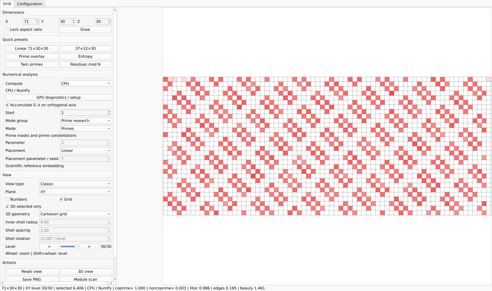

## Native prime viewport export: 564 occupied projected cells among 2130; intensity reflects cumulative hits.

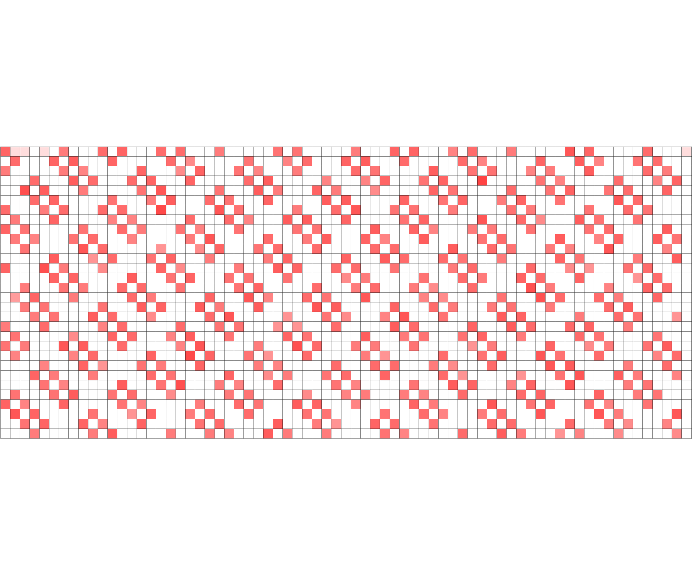

## Coprime support for M = 2130: admissibility under gcd(n, M) = 1, not a primality claim.

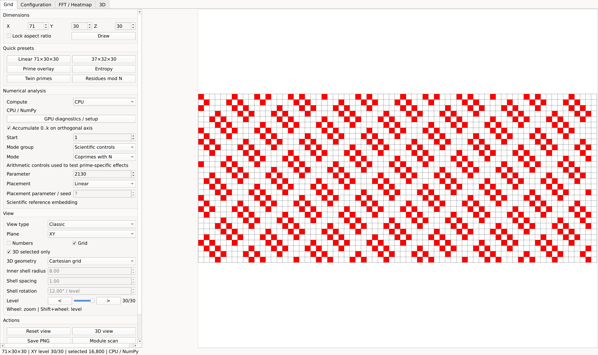

## Native coprime viewport: 560 admissible projected cells, constant through 30 layers.

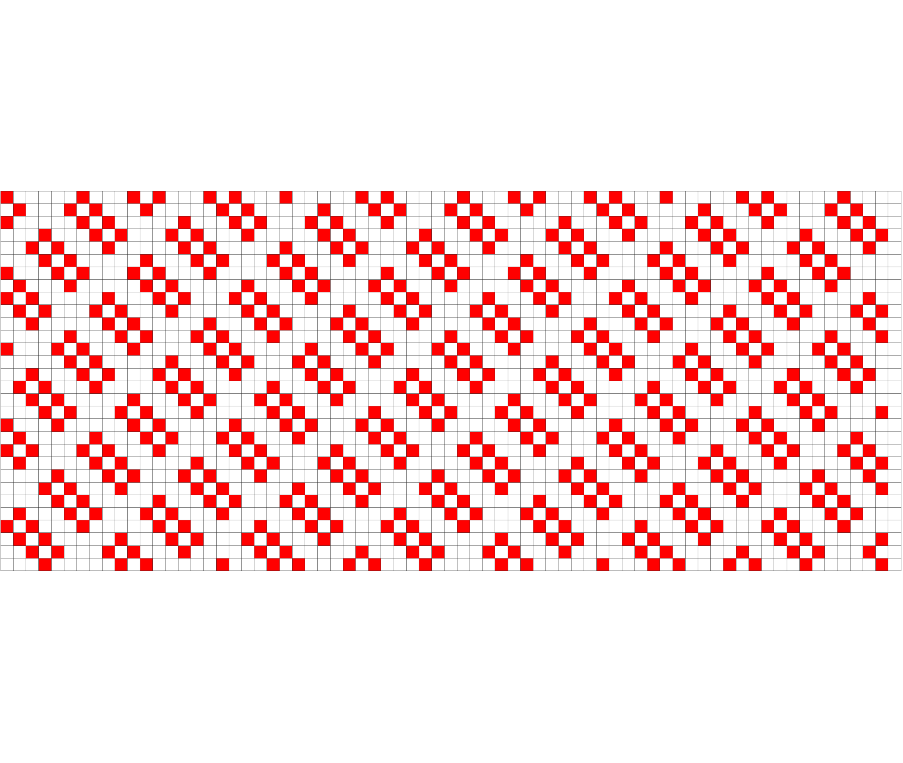

## Actual OpenGL view of 6406 selected prime cells in the Cartesian volume; no subsampling.

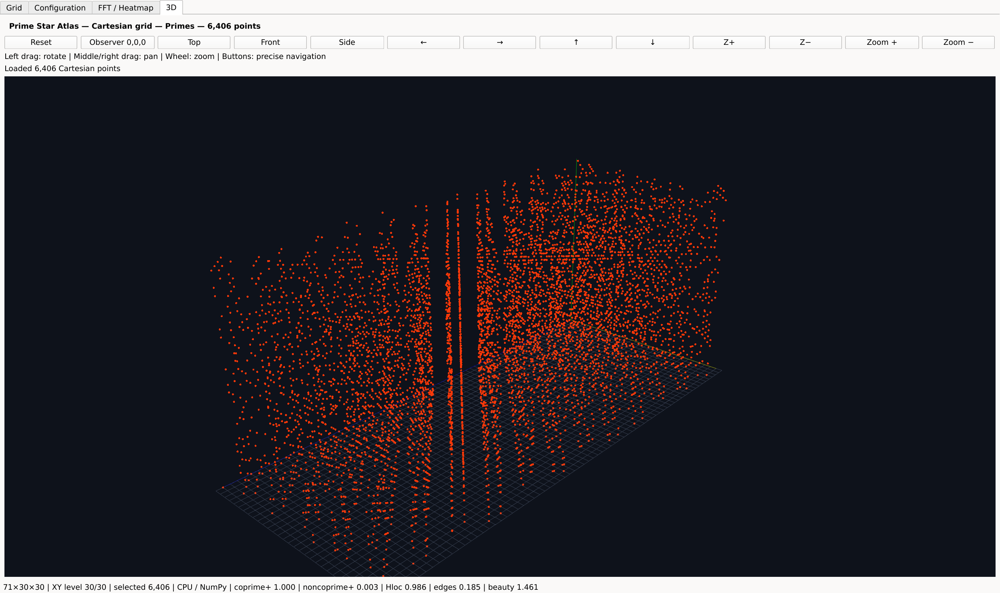

## Native OpenGL framebuffer of the same 6406 submitted prime positions; perspective and occlusion apply.

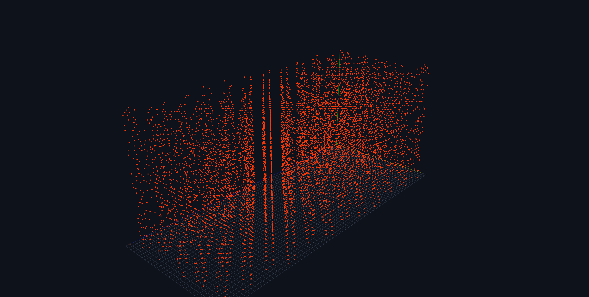

## Mean-centered binary occupancy FFT power, DC removed, displayed as log1p power; qualitative application view.

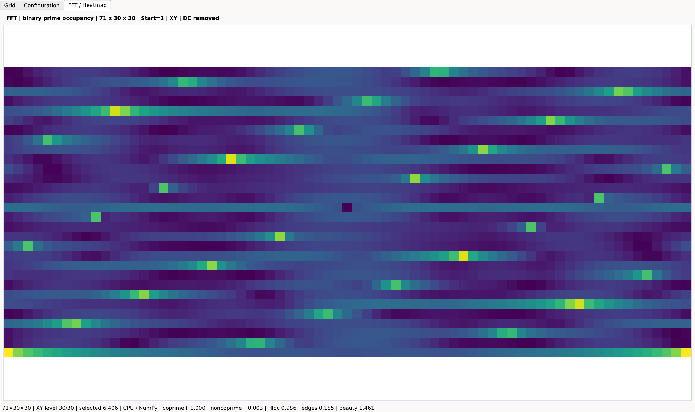

## Actual FFT viewport without quantitative frequency axes or colorbar; numerical matrix supplied separately.

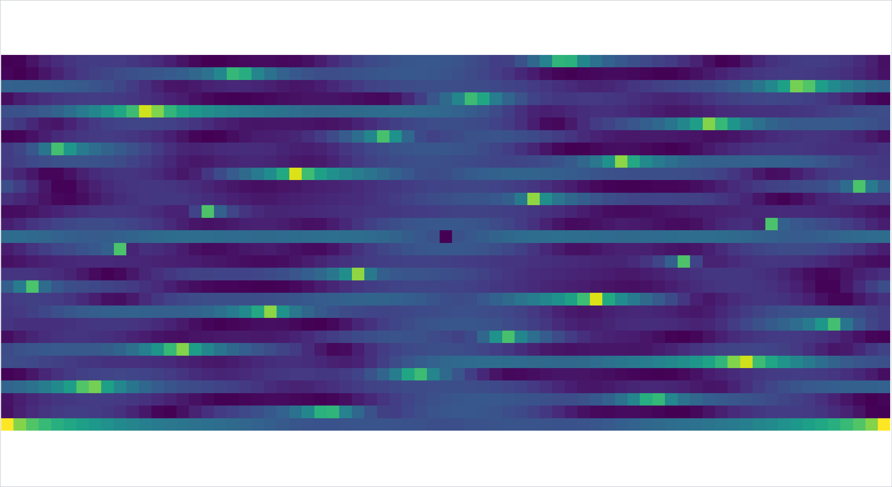

## Native Matplotlib FFT export with array-index axes and colorbar for log1p power.

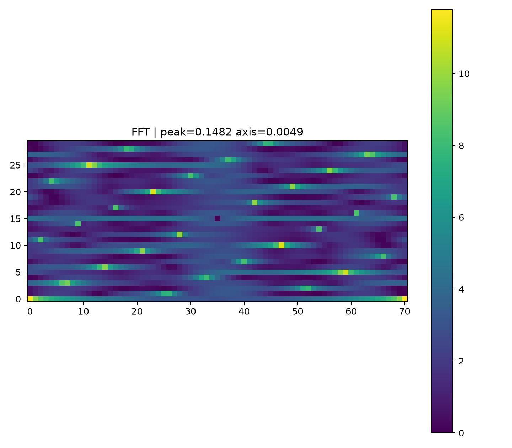

## Fourteen placements of one integer interval; descriptive geometric metrics relative to Linear, not a significance test.

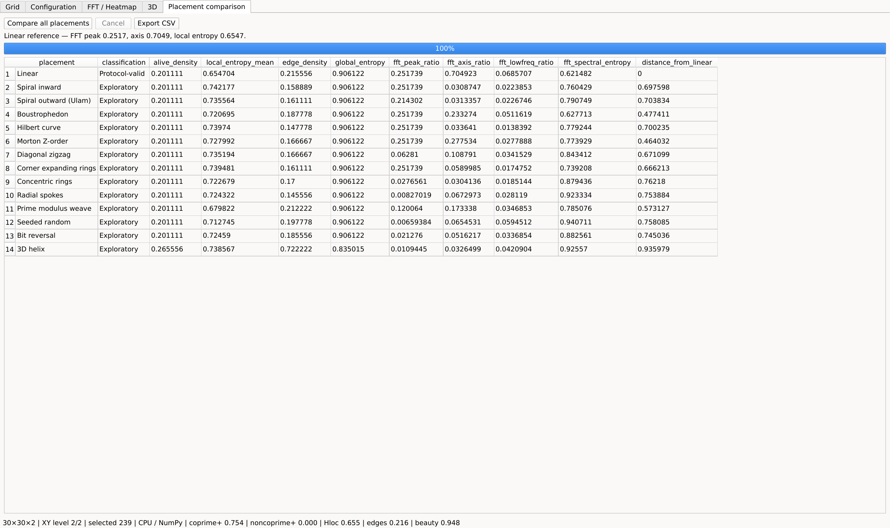

## Completed CPU scan of 49 X/Y pairs at fixed depth; visible table excerpt, with complete CSV supplied.

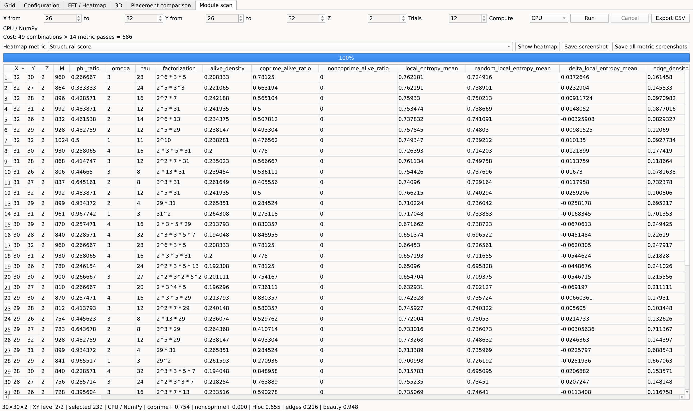

## Reproduce

- [EX-01 — Prime Occupancy](01-prime-occupancy/README.md)
- [EX-02 — Coprimality and Modular Structure](02-coprime-support/README.md)
- [EX-03 — Three-Dimensional Prime Distribution](03-cartesian-3d/README.md)
- [EX-04 — Spectral Analysis](04-fft/README.md)
- [EX-05 — Placement Comparison](05-placement-comparison/README.md)
- [EX-06 — Parametric Scan](06-parametric-scan/README.md)
- [EX-07 — Scientific Provenance](07-provenance-export/README.md)
