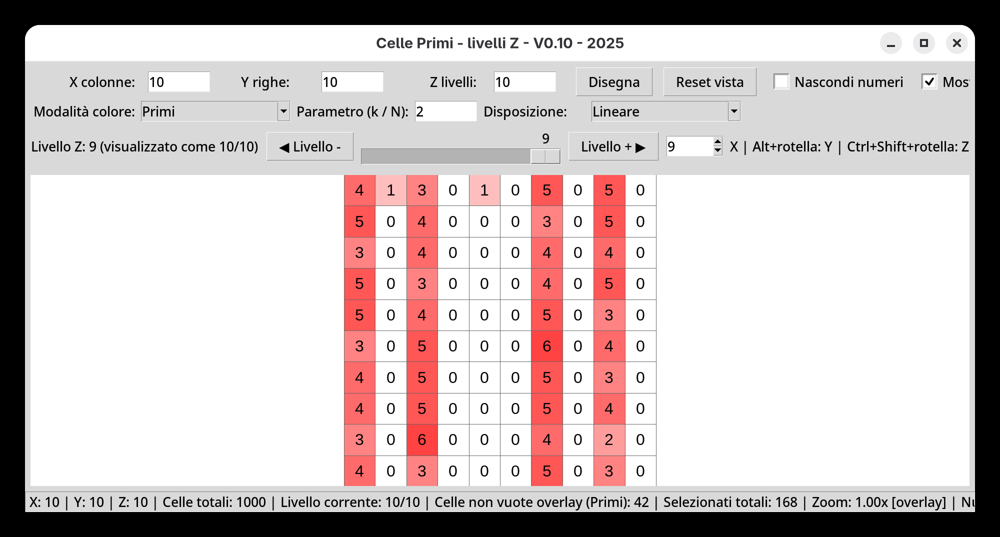

# Project Origins

The idea behind Prime Grid Atlas originated on a Friday evening in October 2025 at my local chess club.

While looking at several mousepad-style vinyl tournament chessboards stacked on top of one another, we were discussing how chess could be played across multiple levels. This raised the question of how to define the coordinates of each square, introducing a third spatial dimension to the conventional chessboard.

From this discussion came the idea of using stacked numerical grids, arranging integers across successive Z layers and cumulatively projecting prime-number occurrences onto a single XY plane to observe their distribution.

## The First Prototype

The first implementation of this idea was **Celle Primi — livelli Z (V0.10)**, a small application written in Python using Tkinter.

The prototype supported configurable grid dimensions, navigation across Z layers, alternative integer placements, selectable zero-based or one-based numbering, and the visualization of arithmetic properties through individual layers and cumulative overlays.

— zampro79

[Original source](celle_primi_v0.10/celle_primi_z.py) · [Technical README](celle_primi_v0.10/README.md) · [Historical gallery](celle_primi_v0.10/gallery.html) · [Italian version](ORIGINS.it.md) · [Prime Grid Atlas](../README.md) · [MIT License](../LICENSE)
